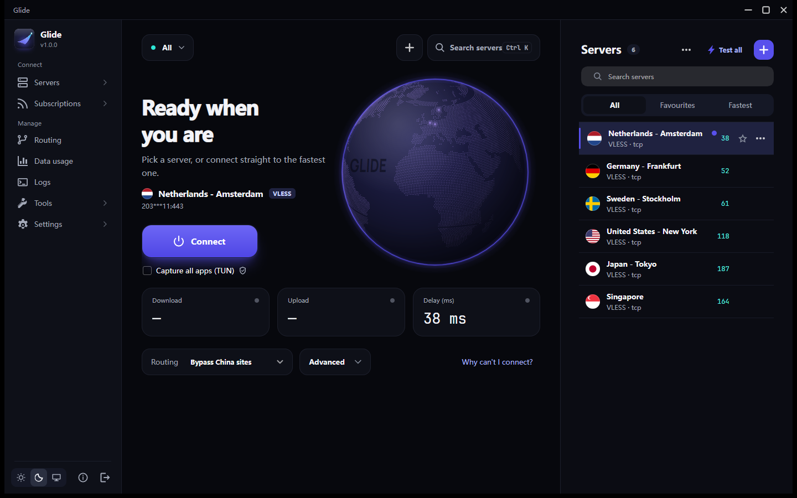

<div align="center">

[English](README.md) · **فارسی**

<br>

<picture>
  <source media="(prefers-color-scheme: dark)" srcset="docs/brand/glide-logo-dark.png">
  
</picture>

<div dir="rtl" align="right">

<h3>قدرت v2rayN، با ظاهری جدید و کاربری ساده‌تر در ویندوز</h3>

<p>Glide از هسته‌های Xray، sing-box و mihomo استفاده می‌کند،<br>اما همه‌چیز را در محیطی مرتب‌تر و راحت‌تر در اختیارتان می‌گذارد.</p>

<p><b>سرورتان را انتخاب کنید، وصل شوید و راحت از اینترنت استفاده کنید.</b></p>

</div>

[](https://github.com/BlackkCore/Glide/releases/latest)
[](https://github.com/BlackkCore/Glide/releases)
[](https://github.com/BlackkCore/Glide/releases/latest)
[](README.md)
[](LICENSE)

<br>

<p dir="rtl" align="center">
  <a href="https://github.com/BlackkCore/Glide/releases/latest/download/Glide-setup-x64.exe"><strong>📥 دانلود نسخهٔ نصبی (x64)</strong></a>
  &nbsp;&nbsp; | &nbsp;&nbsp;
  <a href="https://github.com/BlackkCore/Glide/releases/latest/download/Glide-windows-x64.zip"><strong>📦 دانلود نسخهٔ قابل‌حمل</strong></a>
</p>

<p dir="rtl" align="center">
  🌐 <a href="https://g1ide.pages.dev/"><strong>بازدید از وب‌سایت رسمی Glide</strong></a>
</p>

<sub dir="rtl">ویندوز ۳۲ بیتی دارید؟ فایل مناسب را از <a href="https://github.com/BlackkCore/Glide/releases/latest">صفحهٔ دانلود</a> بگیرید.</sub>

<br><br>


</div>

<br>

<div dir="rtl" align="right">

## ✨ امکانات اصلی

<table dir="rtl">
  <tr>
    <td width="33%" valign="top">
      <h4>⏻ اتصال با یک کلیک</h4>
      کافی است دکمهٔ اتصال را بزنید. Glide قبل از نمایش وضعیت «متصل»، بررسی می‌کند که اینترنت واقعاً از سرور انتخابی عبور می‌کند.
    </td>
    <td width="33%" valign="top">
      <h4>🩺 پیدا کردن مشکل اتصال</h4>
      اگر وصل نشدید، بخش «چرا وصل نمی‌شوم؟» اینترنت، DNS، هسته و سرور را مرحله‌به‌مرحله بررسی می‌کند. امکان بررسی نشت DNS هم وجود دارد.
    </td>
    <td width="33%" valign="top">
      <h4>⚡ انتخاب خودکار سریع‌ترین سرور</h4>
      Glide سرعت سرورها را مرتب بررسی می‌کند و به بهترین سرور در دسترس وصل می‌شود. اگر آن سرور از کار بیفتد، به‌صورت خودکار سرور دیگری انتخاب می‌کند.
    </td>
  </tr>
  <tr>
    <td valign="top">
      <h4>📋 افزودن راحت کانفیگ</h4>
      لینک کانفیگ را کپی کنید و به Glide برگردید تا پیشنهاد افزودن آن را ببینید. قبل از وارد کردن هم می‌توانید محتوای لینک را بررسی کنید.
    </td>
    <td valign="top">
      <h4>📊 مدیریت اشتراک‌ها</h4>
      حجم مصرف‌شده و باقی‌مانده، تاریخ انقضا، زمان آپدیت بعدی و هشدارهای مربوط به اشتراک را یک‌جا ببینید.
    </td>
    <td valign="top">
      <h4>🌙 پشتیبانی کامل از فارسی</h4>
      محیط راست‌به‌چپ، ترجمهٔ فارسی و تنظیمات مسیریابی آماده برای کاربران ایران.
    </td>
  </tr>
  <tr>
    <td valign="top">
      <h4>🌌 ظاهر Midnight Aurora</h4>
      تم روشن و تاریک، رنگ‌های مشخص برای وضعیت اتصال، پرچم کشورها و نمایش پینگ با رنگ‌های مختلف.
    </td>
    <td valign="top">
      <h4>🗂️ مدیریت چند اشتراک</h4>
      هر تعداد اشتراک که دارید اضافه کنید، بین آن‌ها جستجو کنید و حتی اشتراک‌های هم‌نام را از روی آدرسشان تشخیص دهید.
    </td>
    <td valign="top">
      <h4>🧭 دسترسی سریع کنار ساعت</h4>
      از آیکون Glide کنار ساعت ویندوز، وضعیت اتصال را ببینید، وصل یا قطع شوید و بین سرورها جابه‌جا شوید.
    </td>
  </tr>
</table>

## 🔁 تفاوت Glide با v2rayN چیست؟

Glide بر پایهٔ v2rayN ساخته شده و قابلیت‌های اصلی آن را حفظ کرده است. تفاوت اصلی در ظاهر برنامه و امکاناتی است که استفادهٔ روزمره را راحت‌تر می‌کنند.

<table dir="rtl">
  <tr>
    <th width="50%">امکاناتی که از v2rayN حفظ شده‌اند</th>
    <th width="50%">امکانات و تغییرات Glide</th>
  </tr>
  <tr>
    <td valign="top">

- هسته‌های Xray، sing-box و mihomo
- پروتکل‌ها و روش‌های اتصال پشتیبانی‌شده در v2rayN
- سازگاری با فایل‌های تنظیمات و سرورهای قبلی
- قوانین مسیریابی، تنظیمات DNS و حالت TUN
- دریافت و ادغام تغییرات پروژهٔ اصلی

</td>
    <td valign="top">

- بررسی واقعی اتصال، قبل از نمایش وضعیت «متصل»
- عیب‌یابی مرحله‌به‌مرحله و تست نشت DNS
- انتخاب سریع‌ترین سرور و جابه‌جایی خودکار هنگام قطعی
- نمایش حجم، تاریخ انقضا و هشدارهای اشتراک
- پیش‌نمایش کانفیگ و شناسایی لینک‌های کپی‌شده
- تنظیمات ساده و پیشرفته با امکان جستجو
- محیط فارسی و کاملاً راست‌به‌چپ
- تم Midnight Aurora، پرچم کشورها و پینگ رنگی
- مدیریت آسان اشتراک‌ها و منوی سریع کنار ساعت
- انتقال اطلاعات از v2rayN با یک کلیک

</td>
  </tr>
</table>

## 🧭 جزئیات امکانات Glide

<details open>
<summary><b>اتصال و بررسی وضعیت</b></summary>
<br>

- **اتصال با یک دکمه:** پروکسی ویندوز را با دکمهٔ اصلی روشن یا خاموش کنید. وقتی اتصال تأیید شود، دور دکمه یک هالهٔ فیروزه‌ای ظاهر می‌شود. نام و کشور سرور، پروتکل، مدت اتصال، سرعت دانلود و آپلود و در صورت تمایل نمودار سرعت هم نمایش داده می‌شوند.
- **نمایش وضعیت واقعی اتصال:** Glide پیش از نمایش «متصل»، یک تست واقعی انجام می‌دهد و میزان تأخیر را نشان می‌دهد. اگر مشکلی وجود داشته باشد، پیام‌هایی مثل «در حال بررسی اتصال…»، «بدون اینترنت»، «پورت اشغال است» یا «موتور متوقف است» را می‌بینید. در صورت اشغال بودن پورت، نام برنامهٔ مربوط هم نمایش داده می‌شود و برای رفع مشکل راهکار دارید.
- **اعلان قطع و وصل:** وقتی اتصال قطع شود یا دوباره برقرار شود، Glide به شما خبر می‌دهد. تا وقتی مشکلی وجود دارد، یک نقطهٔ قرمز روی آیکون برنامه کنار ساعت دیده می‌شود.
- **«چرا وصل نمی‌شوم؟»:** این ابزار اینترنت، DNS، هستهٔ برنامه، سرور، عبور ترافیک و IP خروجی را بررسی می‌کند و در پایان نتیجه را به زبان ساده توضیح می‌دهد.
- **بررسی نشت DNS:** می‌توانید از داخل برنامه بررسی کنید که درخواست‌های DNS از مسیر موردنظر عبور می‌کنند یا نه.
- **نمایش IP خروجی و کشور:** آی‌پی و کشور اتصال روی کارت وضعیت نمایش داده می‌شود. اگر سرویس اول پاسخ ندهد، Glide سرویس دیگری را امتحان می‌کند.
- **انتخاب خودکار سریع‌ترین سرور:** برای هر اشتراک می‌توانید این حالت را فعال کنید. Glide ابتدا از بهترین سروری که قبلاً تست شده استفاده می‌کند تا اتصال سریع‌تر برقرار شود.
- **تداخل نداشتن با برنامه‌های دیگر:** Glide تنظیمات پروکسی برنامه‌های دیگر را تغییر نمی‌دهد و اگر پورت موردنیاز قبلاً اشغال شده باشد، از همان پورت استفاده نمی‌کند.
- **مسیریابی ساده‌تر:** حالت‌هایی مثل «عبور مستقیم سایت‌های چین»، «فقط سایت‌های مسدود فهرست‌شده» و «همهٔ ترافیک از پروکسی» در دسترس‌اند. اگر زبان برنامه فارسی باشد، در اولین اجرا تنظیمات پیشنهادی ایران نمایش داده می‌شود.
- **حالت TUN برای همهٔ برنامه‌ها:** با توضیح کاربرد آن و مشخص کردن اینکه به دسترسی ادمین نیاز دارد.
- **تنظیمات پیشرفته در جای مناسب:** حالت‌های پروکسی ویندوز (خاموش، روشن، بدون تغییر و PAC) و پورت‌های محلی در بخش پیشرفته قرار دارند. هنگام استفاده از PAC یا حالت «بدون تغییر»، این بخش خودکار باز می‌شود.
- **منوی کنار ساعت:** وضعیت اتصال و نام سرور را ببینید، با یک گزینه وصل یا قطع شوید و سریع به سرورهای خود دسترسی داشته باشید.

</details>

<details>
<summary><b>سرورها و اشتراک‌ها</b></summary>
<br>

- **فهرست خوانای سرورها:** هر سرور در یک ردیف با نام، پرچم کشور، پروتکل، پینگ رنگی و منوی تنظیمات نمایش داده می‌شود. فیروزه‌ای یعنی سریع، کهربایی یعنی کند و قرمز یعنی تست ناموفق. اگر نمای جدولی را ترجیح می‌دهید، آن هم در دسترس است.
- **جستجو و مرتب‌سازی:** سرورها را بر اساس نام یا سرعت مرتب کنید و هم‌زمان با تایپ، نتیجه را ببینید.
- **سرورهای محبوب و اخیر:** سرورهای موردعلاقه بالای فهرست و در منوی کنار ساعت قرار می‌گیرند؛ سرورهای اخیراً استفاده‌شده هم جداگانه در دسترس‌اند.
- **افزودن کانفیگ:** لینک سرور یا سابسکریپشن را وارد کنید و قبل از افزودن، پیش‌نمایش آن را ببینید. اسکن QR از روی صفحه یا تصویر و افزودن دستی برای ۱۲ پروتکل هم پشتیبانی می‌شود.
- **شناسایی لینک کپی‌شده:** اگر لینک معتبری کپی کرده باشید، با برگشتن به Glide پیشنهاد افزودن آن را می‌بینید. این پیشنهاد برای هر لینک فقط یک‌بار نمایش داده می‌شود.
- **مدیریت چند اشتراک:** با یک دکمه فهرست اشتراک‌ها را باز کنید و بینشان جستجو کنید. برای اشتراک‌های هم‌نام، آدرس ارائه‌دهنده هم نشان داده می‌شود.
- **اطلاعات اشتراک:** حجم مصرف‌شده و باقی‌مانده، روزهای مانده تا انقضا و زمان آخرین و آپدیت بعدی را ببینید و قبل از تمام شدن اشتراک هشدار بگیرید.
- **آپدیت اشتراک‌ها:** با راست‌کلیک، اشتراک را همان لحظه آپدیت کنید یا بازهٔ آپدیت خودکار را روی ۶، ۱۲ یا ۲۴ ساعت بگذارید؛ امکان غیرفعال کردنش هم وجود دارد.
- **دسترسی سریع با `Ctrl+K`:** بدون گشتن در منوها، سرور موردنظر را پیدا کنید یا یک دستور را اجرا کنید.
- **ارسال کانفیگ به گوشی:** برای یک سرور یا کل اشتراک کد QR بسازید.

</details>

<details>
<summary><b>تنظیمات، ابزارها و آپدیت‌ها</b></summary>
<br>

- **منوی کناری مرتب:** بخش‌ها در سه گروه «اتصال»، «مدیریت» و «برنامه» قرار دارند. مسیریابی و مصرف داده دم‌دست هستند و ابزارهای دیگر در بخش‌های مربوط قرار گرفته‌اند.
- **تنظیمات ساده و پیشرفته:** ابتدا گزینه‌های پرکاربرد را می‌بینید. برای بقیه، «نمایش تنظیمات پیشرفته» را فعال کنید. با `Ctrl+F` هم می‌توانید بین تنظیمات جستجو کنید.
- **آپدیت همه‌چیز با یک دکمه:** Glide، هسته‌های پروکسی و فایل‌های قوانین را یک‌جا به‌روزرسانی کنید.
- **انتخاب برنامه‌ها برای مسیریابی:** به‌جای نوشتن قوانین دستی، از فهرست برنامه‌های در حال اجرا انتخاب کنید کدام‌ها از پروکسی استفاده کنند و کدام‌ها مستقیم وصل شوند؛ مثلاً تلگرام با پروکسی و برنامهٔ بانکی بدون پروکسی.
- **گزارش مصرف اینترنت:** مصرف امروز، این ماه، مصرف کل و مصرف هر سرور را ببینید. می‌توانید برای مصرف روزانه هم هشدار بگذارید.
- **فایل عیب‌یابی برای پشتیبانی:** گزارش‌ها و تنظیمات اخیر را در یک فایل ZIP خروجی بگیرید؛ بدون رمزها، توکن‌ها و آدرس‌های حساس.
- **حفظ حریم خصوصی در گزارش‌ها:** آدرس سرورها و اشتراک‌ها قبل از ثبت در گزارش به نام کوتاه میزبان تبدیل می‌شوند.
- **فرم سادهٔ افزودن سرور:** تنظیمات کم‌استفاده در بخش «نمایش فیلدهای پیشرفته» قرار دارند تا فرم اصلی شلوغ نشود.

</details>

<details>
<summary><b>ظاهر و تجربهٔ کاربری</b></summary>
<br>

- **تم Midnight Aurora:** رنگ نیلی برای موارد انتخاب‌شده، فیروزه‌ای برای اتصال تأییدشده و کهربایی یا قرمز برای وضعیت‌های کند یا ناموفق استفاده می‌شود. برنامه تم روشن و تاریک دارد و می‌تواند با تنظیمات ویندوز هماهنگ شود.
- **آیکون اختصاصی Aurora:** آیکون برنامه، نصب‌کننده و آیکون کنار ساعت با طراحی یکپارچه؛ با حالت‌های مختلف برای وضعیت پروکسی و PAC.
- **فارسی و راست‌به‌چپ:** رابط کاربری فارسی، چیدمان کامل راست‌به‌چپ و فونت وزیرمتن. متن‌های فارسی در هر نسخه بررسی می‌شوند.
- **مناسب پنجره‌های کوچک:** وقتی پنجره باریک شود، منوی کناری فقط آیکون‌ها را نمایش می‌دهد. بخش گزارش‌ها و نمودار سرعت هم قابل مخفی کردن هستند.
- **هماهنگی با ویندوز ۱۱:** گوشه‌های گرد، نوار عنوان هماهنگ با تم و انیمیشن‌هایی که از تنظیمات ویندوز پیروی می‌کنند.
- **دسترس‌پذیری:** دکمه‌های آیکونی برچسب قابل‌خواندن برای صفحه‌خوان‌ها دارند.
- **انتقال آسان از v2rayN:** Glide هنگام اولین اجرا، v2rayN را پیدا می‌کند و پیشنهاد می‌دهد سرورها، اشتراک‌ها و تنظیمات را منتقل کنید. پیش از انتقال هم از تنظیمات خودش نسخهٔ پشتیبان می‌گیرد.

</details>

## 🖼️ تصاویر برنامه

</div>

<table dir="rtl">
  <tr>
    <td width="50%"></td>
    <td width="50%"></td>
  </tr>
  <tr>
    <td align="center"><sub>نمای برنامه با تم تیره</sub></td>
    <td align="center"><sub>نمای برنامه با تم روشن</sub></td>
  </tr>
  <tr>
    <td width="50%"></td>
    <td width="50%"></td>
  </tr>
  <tr>
    <td align="center"><sub>افزودن سرور با لینک یا اشتراک</sub></td>
    <td align="center"><sub>به‌روزرسانی‌ها زیر کنترل شماست</sub></td>
  </tr>
  <tr>
    <td width="50%"></td>
    <td width="50%"></td>
  </tr>
  <tr>
    <td align="center"><sub>تنظیمات مرتب با امکان جستجو</sub></td>
    <td align="center"><sub>برنامه‌های فروشگاه ویندوز (فهرست در اینجا فیلتر شده است)</sub></td>
  </tr>
  <tr>
    <td width="50%"></td>
    <td width="50%"></td>
  </tr>
  <tr>
    <td align="center"><sub>داده‌های مسیریابی یک بار و با اجازهٔ شما دانلود می‌شوند</sub></td>
    <td align="center"><sub>انتخاب زبان: English و فارسی</sub></td>
  </tr>
</table>

<div dir="rtl" align="right">

## 🚀 نصب و شروع کار

۱. **دانلود و نصب:** فایل [`Glide-setup-x64.exe`](https://github.com/BlackkCore/Glide/releases/latest/download/Glide-setup-x64.exe) را دانلود و اجرا کنید. ویندوز اجازهٔ مدیر می‌خواهد (Glide در `Program Files` نصب می‌شود). میان‌بر منوی Start و گزینهٔ حذف برنامه هم ساخته می‌شوند و سرورها و تنظیمات شما در `%LOCALAPPDATA%\Glide` می‌ماند.<br>
<sub>اگر نسخهٔ پرتابل می‌خواهید، فایل `Glide-windows-x64.zip` را دانلود کنید و در پوشه‌ای مثل `C:\Glide` از حالت فشرده خارج کنید؛ بهتر است از `Program Files` استفاده نکنید. نسخه‌های ۳۲ بیتی هم در صفحهٔ انتشار قرار دارند. هسته‌های موردنیاز داخل بسته هستند.</sub><br>
۲. **خروج از v2rayN:** اگر v2rayN باز است، روی آیکون آن کنار ساعت راست‌کلیک کنید و گزینهٔ خروج را بزنید.<br>
۳. **اجرای Glide:** اگر از v2rayN استفاده می‌کردید، می‌توانید اطلاعات قبلی را منتقل کنید. در غیر این صورت روی **افزودن سرور** بزنید و لینک کانفیگ یا سابسکریپشن را وارد کنید.<br>
۴. **برقراری اتصال:** دکمهٔ اصلی را بزنید. بار اول ممکن است Glide بگوید به داده‌های مسیریابی نیاز دارد (حدود ۴۵ مگابایت) و دکمهٔ «دانلود فهرست سایت‌ها» را نشان دهد؛ این داده‌ها یک بار از منابع عمومی در GitHub دانلود می‌شوند و هنگام به‌روزرسانی حفظ می‌شوند. اگر وضعیت «متصل» نمایش داده شد، آماده‌اید. اگر نه، از بخش «چرا وصل نمی‌شوم؟» کمک بگیرید.

**سیستم موردنیاز:** ویندوز ۱۰ یا ۱۱، نسخهٔ ۳۲ یا ۶۴ بیتی.

> [!TIP]
> می‌توانید Glide و v2rayN را روی یک سیستم نصب داشته باشید، اما بهتر است هم‌زمان اجراشان نکنید؛ چون ممکن است هر دو بخواهند از یک پورت محلی و تنظیمات پروکسی ویندوز استفاده کنند.

## 🔄 به‌روزرسانی برنامه

- **نسخهٔ نصب‌شده:** در نوار کناری **بررسی به‌روزرسانی** را باز کنید و **به‌روزرسانی همه** را بزنید: Glide (امضا بررسی می‌شود)، هسته‌ها (فقط نسخه‌هایی که در فهرست امضاشدهٔ Glide آمده‌اند) و فایل‌های قوانین. هنگام نصب در `Program Files` ویندوز یک بار اجازهٔ مدیر می‌خواهد؛ خود Glide بدون آن اجرا می‌شود. اگر رد کنید، چیزی تغییر نمی‌کند.
- **نسخهٔ پرتابل:** **به‌روزرسانی همه** را بزنید تا برنامه، هسته‌ها (فقط نسخه‌هایی که در فهرست امضاشدهٔ Glide آمده‌اند) و فایل‌های قوانین با هم به‌روز شوند. یا ZIP جدید را روی پوشهٔ قبلی استخراج کنید. اطلاعات سرورها در پوشهٔ `guiConfigs` نگهداری می‌شود؛ پیش از جایگزین کردن فایل‌ها بهتر است از آن بکاپ بگیرید.

Glide تغییرات پروژهٔ اصلی [2dust/v2rayN](https://github.com/2dust/v2rayN) را دنبال می‌کند و آن‌ها را در نسخه‌های جدید خود ادغام می‌کند.

## ❓ سؤال‌های متداول

<details>
<summary><b>Glide از نظر حریم خصوصی چطور کار می‌کند؟</b></summary>
<br>

Glide برای اتصال به سرورها و آپدیت سابسکریپشن‌ها از آدرس‌هایی استفاده می‌کند که خودتان وارد کرده‌اید. همچنین برای بررسی آپدیت به GitHub و برای تست اتصال به یک آدرس آزمایشی وصل می‌شود. نمایش IP خروجی با اجازهٔ شما فعال می‌شود و تست نشت DNS فقط زمانی اجرا می‌شود که خودتان درخواست کنید. این دو بررسی از مسیر پروکسی انجام می‌شوند. اطلاعات حساس هم از گزارش‌های عیب‌یابی حذف می‌شوند.

</details>

<details>
<summary><b>می‌توانم سرورها و تنظیمات v2rayN را به Glide منتقل کنم؟</b></summary>
<br>

بله. Glide با فرمت تنظیمات v2rayN سازگار است و در اولین اجرا پیشنهاد می‌دهد سرورها و تنظیماتتان را منتقل کنید. پوشه و فایل‌های اصلی v2rayN تغییر نمی‌کنند.

</details>

<details>
<summary><b>چرا Windows SmartScreen هنگام اجرا هشدار می‌دهد؟</b></summary>
<br>

گاهی ویندوز برای برنامه‌های جدیدی که گواهی امضای کد تجاری ندارند هشدار نمایش می‌دهد. قبل از اجرا، مطمئن شوید فایل را از صفحهٔ رسمی پروژه دانلود کرده‌اید و در صورت تمایل امضای GPG آن را طبق راهنمای پایین بررسی کنید. اگر به فایل اعتماد دارید، می‌توانید از گزینه‌های *More info* و *Run anyway* استفاده کنید.

</details>

## 🔐 بررسی اصالت فایل دانلودشده

در صفحهٔ هر انتشار، برای فایل‌ها یک امضای دیجیتال با پسوند `.sig` قرار داده شده است. اثر انگشت کلید امضا:

</div>

```text
218B 01F2 5642 A7A3 91BF  CC86 7D63 C285 D104 63CB
```

```bash
gpg --import Glide-public-key.asc
gpg --verify Glide-windows-x64.zip.sig Glide-windows-x64.zip
```

<div dir="rtl" align="right">

فایل `Glide-public-key.asc` را هم از صفحهٔ انتشار دانلود کنید. اگر امضا معتبر باشد، عبارت `Good signature from "BlackCore Glide Release"` را در خروجی می‌بینید. برای اطمینان بیشتر، اثر انگشت کلید را با یک منبع مطمئن مقایسه کنید.

هر فایل ZIP یک فایل `.sig256` هم دارد که خود Glide پیش از نصب به‌روزرسانی بررسی می‌کند. کد منبع Glide و هسته‌های همراه آن (فایل‌های `*-source*.tar.gz` به‌همراه `SHA256SUMS-source-<نسخه>.txt`) به هر انتشار پیوست می‌شود تا بتوانید آنچه دانلود کرده‌اید را دوباره بسازید.

## 🛠️ ساخت برنامه از سورس

برای ساخت Glide به [.NET 10 SDK](https://dotnet.microsoft.com/download) نیاز دارید:

</div>

```bash
git clone https://github.com/BlackkCore/Glide.git
cd Glide/v2rayN/v2rayN.Desktop
dotnet publish -c Release -r win-x64 --self-contained true -o ../../out
```

<div dir="rtl" align="right">

پوشهٔ `bin` که فایل‌های هسته‌ها داخل آن قرار دارند را کنار `Glide.exe` بگذارید. راه دیگر این است که هسته‌ها را از بخش **بررسی به‌روزرسانی** در خود برنامه دانلود کنید.

<section dir="rtl" align="right">

<h2>سازندگان، حقوق نشر و مجوز</h2>

<p>نرم‌افزار <bdi dir="ltr">Glide</bdi> توسط <a href="https://github.com/BlackkCore"><bdi dir="ltr">BlackCore</bdi></a> توسعه داده شده و نگهداری می‌شود.</p>

<p>این نرم‌افزار بر پایهٔ پروژهٔ متن‌باز <a href="https://github.com/2dust/v2rayN"><bdi dir="ltr">v2rayN</bdi></a>، ساخته‌شده توسط <a href="https://github.com/2dust"><bdi dir="ltr">2dust</bdi></a> و مشارکت‌کنندگان آن، توسعه یافته است. <bdi dir="ltr">Glide</bdi> رابط کاربری را بازطراحی کرده و قابلیت‌های شبکهٔ پروژهٔ اصلی را حفظ می‌کند.</p>

<h3>توسعه‌دهندگان و ارجاع به سازندگان</h3>

<ul dir="rtl">
<li><strong>توسعه‌دهنده و نگهدارنده:</strong> <a href="https://github.com/BlackkCore"><bdi dir="ltr">BlackCore</bdi></a></li>
<li><strong>حقوق نشر مشارکت‌های اصلی:</strong> © ۲۰۲۶ <bdi dir="ltr">BlackCore</bdi> و دیگر صاحبان حقوق مربوطه.</li>
<li><strong>پروژهٔ پایه:</strong> <a href="https://github.com/2dust/v2rayN"><bdi dir="ltr">v2rayN</bdi></a></li>
<li><strong>موتورهای ارتباطی:</strong> <a href="https://github.com/XTLS/Xray-core"><bdi dir="ltr">Xray</bdi></a>، <a href="https://github.com/SagerNet/sing-box"><bdi dir="ltr">sing-box</bdi></a> و <a href="https://github.com/MetaCubeX/mihomo"><bdi dir="ltr">mihomo</bdi></a></li>
<li><strong>رابط کاربری:</strong> <a href="https://avaloniaui.net/"><bdi dir="ltr">Avalonia</bdi></a> و <a href="https://github.com/irihitech/Semi.Avalonia"><bdi dir="ltr">Semi.Avalonia</bdi></a></li>
<li><strong>فونت‌ها:</strong> <bdi dir="ltr">Manrope</bdi>، <bdi dir="ltr">Vazirmatn</bdi> و <bdi dir="ltr">JetBrains Mono</bdi> (تحت مجوز <bdi dir="ltr">SIL Open Font License</bdi>)</li>
<li><strong>داده‌های مسیریابی (هنگام اولین استفاده در برنامه دانلود می‌شوند و همراه برنامه نیستند):</strong> <bdi dir="ltr">geosite.dat</bdi> و <bdi dir="ltr">geoip.dat</bdi> از <a href="https://github.com/Loyalsoldier/v2ray-rules-dat"><bdi dir="ltr">Loyalsoldier/v2ray-rules-dat</bdi></a> (<bdi dir="ltr">GPL-3.0</bdi>، بر پایهٔ <a href="https://github.com/v2fly/domain-list-community"><bdi dir="ltr">v2fly/domain-list-community</bdi></a> با مجوز <bdi dir="ltr">MIT</bdi>)، <bdi dir="ltr">Country.mmdb</bdi> و <bdi dir="ltr">geoip-only-cn-private.dat</bdi> از <a href="https://github.com/Loyalsoldier/geoip"><bdi dir="ltr">Loyalsoldier/geoip</bdi></a> (<bdi dir="ltr">CC-BY-SA-4.0</bdi>) و <bdi dir="ltr">geoip.metadb</bdi> از <a href="https://github.com/MetaCubeX/meta-rules-dat"><bdi dir="ltr">MetaCubeX/meta-rules-dat</bdi></a> (<bdi dir="ltr">GPL-3.0</bdi>). <bdi dir="ltr">This product includes GeoLite Data created by MaxMind, available from https://www.maxmind.com.</bdi></li>
</ul>

<h3>مجوز</h3>

<p><bdi dir="ltr">Glide</bdi> تحت <a href="LICENSE">مجوز عمومی گنو نسخهٔ ۳ (<bdi dir="ltr">GPL-3.0</bdi>)</a> منتشر می‌شود.</p>

<p>کپی، تغییر و توزیع مجدد این نرم‌افزار مطابق شرایط <bdi dir="ltr">GPL-3.0</bdi> مجاز است، به شرط رعایت الزامات مجوز و حفظ اطلاعیه‌های حقوق نشر و مجوزهای مربوطه.</p>

<p>برای جزئیات بیشتر دربارهٔ حقوق نشر و ارجاع به سازندگان، فایل <a href="NOTICE.md"><bdi dir="ltr">NOTICE.md</bdi></a> را مطالعه کنید.</p>

<p><strong>مخزن رسمی پروژه:</strong> <a href="https://github.com/BlackkCore/Glide"><bdi dir="ltr">Glide by BlackCore</bdi></a></p>

</section>
</div>

<div align="center" dir="rtl">
<br>

اگر با مشکلی روبه‌رو شدید یا پیشنهادی دارید، از طریق [**بخش Issues**](https://github.com/BlackkCore/Glide/issues/new/choose) با ما در میان بگذارید.

<sub>اگر Glide برایتان مفید بوده، با دادن ⭐ به مخزن GitHub کمک کنید افراد بیشتری آن را پیدا کنند.</sub>

</div>
