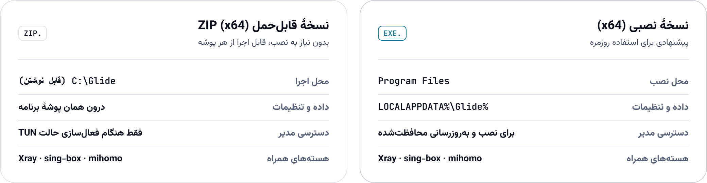
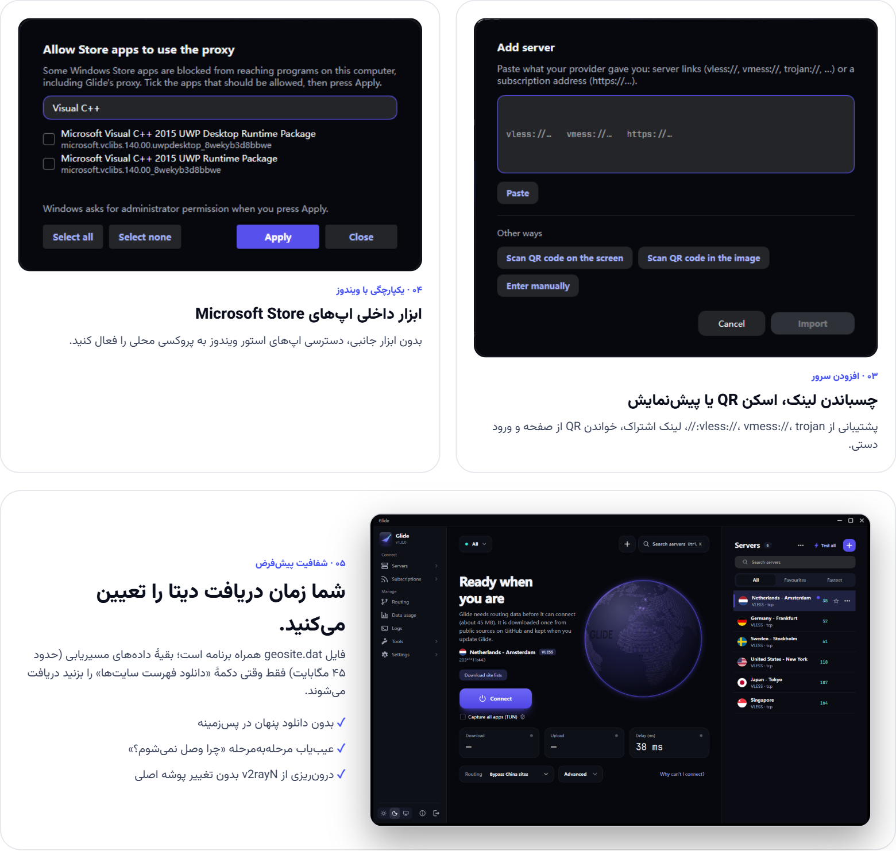

<!-- نسخهٔ فارسی README مربوط به Glide | ترتیب بخش‌ها و محتوا هم‌سان با README.md -->
<div align="center" dir="rtl">

<a href="README.md">English</a> &nbsp;·&nbsp; <strong>فارسی</strong> &nbsp;&nbsp;|&nbsp;&nbsp; [**دانلود**](#get-started) · [**امکانات**](#features) · [**تصاویر برنامه**](#screenshots) · [**تفاوت با v2rayN**](#glide-vs-v2rayn) · [**پرسش‌ها**](#faq) · [**بررسی اصالت**](#verify-your-download) · [**ساخت از سورس**](#build-from-source)

<picture>
  <source media="(prefers-color-scheme: dark)" srcset="docs/images/readme/fa-hero-header-dark.png">
  
</picture>

[](https://github.com/BlackkCore/Glide/releases/latest)
[](https://github.com/BlackkCore/Glide/releases)

<a href="https://github.com/BlackkCore/Glide/releases/latest/download/Glide-setup-x64.exe"><picture><source media="(prefers-color-scheme: dark)" srcset="docs/images/readme/fa-cta-installer-dark.png"></picture></a>&nbsp;&nbsp;<a href="https://github.com/BlackkCore/Glide/releases/latest/download/Glide-windows-x64.zip"><picture><source media="(prefers-color-scheme: dark)" srcset="docs/images/readme/fa-cta-portable-dark.png"></picture></a>

<sub>ویندوز ۱۰ و ۱۱ (x64) · <a href="https://github.com/BlackkCore/Glide/releases/latest">فایل‌های ۳۲ بیتی و همهٔ نسخه‌ها</a> · <a href="https://g1ide.pages.dev/">وب‌سایت</a></sub>

<br><br>

<picture>
  <source media="(prefers-color-scheme: dark)" srcset="docs/images/readme/fa-hero-stage-dark.png">
  
</picture>

</div>

<div dir="rtl">

<a id="features"></a>

## امکانات

همهٔ امکانات ضروری، بدون شلوغی؛ از اولین اتصال تا صدمین.

</div>

<picture>
  <source media="(prefers-color-scheme: dark)" srcset="docs/images/readme/fa-bento-features-dark.png">
  
</picture>

<p align="center" dir="rtl"><sub><b>وضعیت تأییدشده</b> · <b>به‌روزرسانی امضاشده</b> · <b>عیب‌یابی مرحله‌به‌مرحله</b> · <b>سریع‌ترین سرور</b> · <b>دسترسی سریع Ctrl+K</b> · <b>کنترل از کنار ساعت</b> · <b>Midnight Aurora</b> · <b>فارسی و راست‌به‌چپ</b></sub></p>

<div dir="rtl">

<a id="get-started"></a>

## نصب و شروع کار

در کمتر از یک دقیقه جابه‌جا شوید. نسخهٔ نصبی و نسخهٔ قابل‌حمل هر دو هسته‌های Xray، sing-box و mihomo را همراه دارند.

</div>

<div align="center">

<a href="https://github.com/BlackkCore/Glide/releases/latest/download/Glide-setup-x64.exe"><picture><source media="(prefers-color-scheme: dark)" srcset="docs/images/readme/fa-cta-installer-dark.png"></picture></a>&nbsp;&nbsp;<a href="https://github.com/BlackkCore/Glide/releases/latest/download/Glide-windows-x64.zip"><picture><source media="(prefers-color-scheme: dark)" srcset="docs/images/readme/fa-cta-portable-dark.png"></picture></a>

<picture>
  <source media="(prefers-color-scheme: dark)" srcset="docs/images/readme/fa-install-compare-dark.png">
  
</picture>

</div>

<div dir="rtl">

۱. **دانلود و نصب:** فایل [`Glide-setup-x64.exe`](https://github.com/BlackkCore/Glide/releases/latest/download/Glide-setup-x64.exe) را دانلود و اجرا کنید. ویندوز اجازهٔ مدیر می‌خواهد (Glide در `Program Files` نصب می‌شود). میان‌بر منوی Start و گزینهٔ حذف برنامه هم ساخته می‌شوند و سرورها و تنظیمات شما در `%LOCALAPPDATA%\Glide` می‌ماند.<br>
<sub>اگر نسخهٔ قابل‌حمل می‌خواهید، فایل `Glide-windows-x64.zip` را دانلود کنید و در پوشه‌ای مثل `C:\Glide` از حالت فشرده خارج کنید؛ بهتر است از `Program Files` استفاده نکنید. نسخه‌های ۳۲ بیتی هم در صفحهٔ انتشار قرار دارند. هسته‌های موردنیاز داخل بسته هستند.</sub><br>
۲. **خروج از v2rayN:** اگر v2rayN باز است، روی آیکون آن کنار ساعت راست‌کلیک کنید و گزینهٔ خروج را بزنید.<br>
۳. **اجرای Glide:** اگر از v2rayN استفاده می‌کردید، می‌توانید اطلاعات قبلی را منتقل کنید. در غیر این صورت روی **افزودن سرور** بزنید و لینک کانفیگ یا لینک اشتراک را وارد کنید.<br>
۴. **برقراری اتصال:** دکمهٔ اصلی را بزنید. بار اول ممکن است Glide بگوید به داده‌های مسیریابی نیاز دارد (حدود ۴۵ مگابایت) و دکمهٔ «دانلود فهرست سایت‌ها» را نشان دهد؛ این داده‌ها یک بار از منابع عمومی در GitHub دانلود می‌شوند و هنگام به‌روزرسانی حفظ می‌شوند. اگر وضعیت «متصل» نمایش داده شد، آماده‌اید. اگر نه، از بخش «چرا وصل نمی‌شوم؟» کمک بگیرید.

**سیستم موردنیاز:** ویندوز ۱۰ یا ۱۱، نسخهٔ ۳۲ یا ۶۴ بیتی.

> [!TIP]
> Glide و v2rayN می‌توانند کنار هم نصب بمانند، فقط هم‌زمان اجراشان نکنید؛ هر دو از یک پورت محلی و یک تنظیم پروکسی ویندوز استفاده می‌کنند.

<a id="screenshots"></a>

## تصاویر برنامه

</div>

<picture>
  <source media="(prefers-color-scheme: dark)" srcset="docs/images/readme/fa-showcase-curated-dark.png">
  
</picture>

<details dir="rtl">
<summary><strong>تصاویر بیشتر:</strong> افزودن سرور، اپ‌های Microsoft Store، دریافت داده در اولین اجرا</summary>
<br>

<picture>
  <source media="(prefers-color-scheme: dark)" srcset="docs/images/readme/fa-showcase-more-dark.png">
  
</picture>

</details>

<div dir="rtl">

<a id="glide-vs-v2rayn"></a>

## تفاوت با v2rayN

> [!NOTE]
> Glide یک برنامهٔ دسکتاپ بازطراحی‌شده **بر پایهٔ v2rayN** است، نه یک هستهٔ پروکسی جداگانه. اتصال تأییدشده یعنی ترافیک از سرور شما عبور می‌کند؛ این به آن معنا نیست که همهٔ برنامه‌ها ناشناس یا محافظت‌شده‌اند.

**Glide در اصل همان v2rayN است، با رابط کاربری جدید و چند بهبود کاربردی.** پروتکل‌ها، روش‌های انتقال، فرمت پیکربندی، هسته‌ها، مسیریابی، DNS و TUN پروژهٔ اصلی حفظ شده‌اند. Glide علاوه بر بازطراحی نحوهٔ استفاده از آن‌ها، وضعیت تأییدشدهٔ اتصال، به‌روزرسانی امضاشده (برای Glide، هسته‌ها و فایل‌های قوانین)، نصب برای همهٔ کاربران و رابط فارسی را اضافه کرده است.

</div>

<picture>
  <source media="(prefers-color-scheme: dark)" srcset="docs/images/readme/fa-upstream-diff-dark.png">
  
</picture>

<picture>
  <source media="(prefers-color-scheme: dark)" srcset="docs/images/readme/fa-verify-flow-dark.png">
  
</picture>

<div dir="rtl">

Glide تغییرات پروژهٔ اصلی [2dust/v2rayN](https://github.com/2dust/v2rayN) را دنبال می‌کند: نسخه‌های جدید آن ادغام می‌شوند و همراه با بازطراحی در این مخزن منتشر می‌شوند.

<a id="details"></a>

## همهٔ امکانات

<details open>
<summary><b>اتصال و بررسی وضعیت</b></summary>
<br>

- **اتصال با یک دکمه:** پروکسی ویندوز را با دکمهٔ اصلی روشن یا خاموش کنید. وقتی اتصال تأیید شود، دور دکمه یک هالهٔ فیروزه‌ای ظاهر می‌شود. نام و کشور سرور، پروتکل، مدت اتصال، سرعت دانلود و آپلود و در صورت تمایل نمودار سرعت هم نمایش داده می‌شوند.
- **نمایش وضعیت واقعی اتصال:** Glide پیش از نمایش «متصل»، یک تست واقعی انجام می‌دهد و میزان تأخیر را نشان می‌دهد. اگر مشکلی وجود داشته باشد، پیام‌هایی مثل «در حال بررسی اتصال…»، «بدون اینترنت»، «پورت اشغال است» یا «موتور متوقف است» را می‌بینید. در صورت اشغال بودن پورت، نام برنامهٔ مربوط هم نمایش داده می‌شود و برای رفع مشکل راهکار دارید.
- **اعلان قطع و وصل:** وقتی اتصال قطع شود یا دوباره برقرار شود، Glide به شما خبر می‌دهد. تا وقتی مشکلی وجود دارد، یک نقطهٔ قرمز روی آیکون برنامه کنار ساعت دیده می‌شود.
- **«چرا وصل نمی‌شوم؟»:** این ابزار اینترنت، DNS، هستهٔ برنامه، سرور، عبور ترافیک و IP خروجی را بررسی می‌کند و در پایان نتیجه را به زبان ساده توضیح می‌دهد.
- **بررسی نشت DNS:** می‌توانید از داخل برنامه بررسی کنید که درخواست‌های DNS از مسیر موردنظر عبور می‌کنند یا نه.
- **نمایش IP خروجی و کشور:** آی‌پی و کشور اتصال، پس از اجازهٔ شما، روی کارت وضعیت نمایش داده می‌شود. اگر سرویس اول پاسخ ندهد، Glide سرویس دیگری را امتحان می‌کند.
- **انتخاب خودکار سریع‌ترین سرور:** برای هر اشتراک می‌توانید این حالت را فعال کنید. Glide ابتدا از بهترین سروری که قبلاً تست شده استفاده می‌کند تا اتصال سریع‌تر برقرار شود.
- **تداخل نداشتن با برنامه‌های دیگر:** Glide تنظیمات پروکسی برنامه‌های دیگر را تغییر نمی‌دهد و اگر پورت موردنیاز قبلاً اشغال شده باشد، از همان پورت استفاده نمی‌کند.
- **مسیریابی ساده‌تر:** حالت‌هایی مثل «عبور مستقیم سایت‌های چین»، «فقط سایت‌های مسدود فهرست‌شده» و «همهٔ ترافیک از پروکسی» در دسترس‌اند. اگر زبان برنامه فارسی باشد، در اولین اجرا تنظیمات پیشنهادی ایران نمایش داده می‌شود.
- **حالت TUN برای همهٔ برنامه‌ها:** با توضیح کاربرد آن و مشخص کردن اینکه به دسترسی مدیر نیاز دارد.
- **تنظیمات پیشرفته در جای مناسب:** حالت‌های پروکسی ویندوز (خاموش، روشن، بدون تغییر و PAC) و پورت‌های محلی در بخش پیشرفته قرار دارند. هنگام استفاده از PAC یا حالت «بدون تغییر»، این بخش خودکار باز می‌شود.
- **منوی کنار ساعت:** وضعیت اتصال و نام سرور را ببینید، با یک گزینه وصل یا قطع شوید و سریع به سرورهای محبوب خود دسترسی داشته باشید.

</details>

<details>
<summary><b>سرورها و اشتراک‌ها</b></summary>
<br>

- **فهرست خوانای سرورها:** هر سرور در یک ردیف با نام، پرچم کشور، پروتکل، پینگ رنگی و منوی تنظیمات نمایش داده می‌شود. فیروزه‌ای یعنی سریع، کهربایی یعنی کند و قرمز یعنی تست ناموفق. اگر نمای جدولی را ترجیح می‌دهید، آن هم در دسترس است.
- **جستجو و مرتب‌سازی:** سرورها را بر اساس نام یا سرعت مرتب کنید و هم‌زمان با تایپ، نتیجه را ببینید.
- **سرورهای محبوب و اخیر:** سرورهای موردعلاقه بالای فهرست و در منوی کنار ساعت قرار می‌گیرند؛ سرورهای اخیراً استفاده‌شده هم جداگانه در دسترس‌اند.
- **افزودن کانفیگ:** لینک سرور یا لینک اشتراک را وارد کنید و قبل از افزودن، پیش‌نمایش آن را ببینید. اسکن QR از روی صفحه یا تصویر و افزودن دستی برای ۱۲ پروتکل هم پشتیبانی می‌شود.
- **شناسایی لینک کپی‌شده:** اگر لینک معتبری کپی کرده باشید، با برگشتن به Glide پیشنهاد افزودن آن را می‌بینید. این پیشنهاد برای هر لینک فقط یک‌بار نمایش داده می‌شود.
- **مدیریت چند اشتراک:** با یک دکمه فهرست اشتراک‌ها را باز کنید و بینشان جستجو کنید. برای اشتراک‌های هم‌نام، آدرس ارائه‌دهنده هم نشان داده می‌شود.
- **اطلاعات اشتراک:** حجم مصرف‌شده و باقی‌مانده، روزهای مانده تا انقضا و زمان آخرین و به‌روزرسانی بعدی را ببینید و قبل از تمام شدن اشتراک هشدار بگیرید.
- **به‌روزرسانی اشتراک‌ها:** با راست‌کلیک، اشتراک را همان لحظه به‌روزرسانی کنید یا بازهٔ به‌روزرسانی خودکار را روی ۶، ۱۲ یا ۲۴ ساعت بگذارید؛ امکان غیرفعال کردنش هم وجود دارد.
- **دسترسی سریع با `Ctrl+K`:** بدون گشتن در منوها، سرور موردنظر را پیدا کنید یا یک دستور را اجرا کنید.
- **ارسال کانفیگ به گوشی:** برای یک سرور یا کل اشتراک کد QR بسازید.

</details>

<details>
<summary><b>تنظیمات، ابزارها و ظاهر</b></summary>
<br>

- **منوی کناری مرتب:** بخش‌ها در سه گروه «اتصال»، «مدیریت» و «برنامه» قرار دارند. مسیریابی و مصرف داده دم‌دست هستند و ابزارهای دیگر در بخش‌های مربوط قرار گرفته‌اند.
- **تنظیمات ساده و پیشرفته:** ابتدا گزینه‌های پرکاربرد را می‌بینید. برای بقیه، «نمایش تنظیمات پیشرفته» را فعال کنید. با `Ctrl+F` هم می‌توانید بین تنظیمات جستجو کنید.
- **به‌روزرسانی همه‌چیز با یک دکمه:** Glide، هسته‌های پروکسی (فقط نسخه‌های موجود در فهرست امضاشدهٔ Glide) و فایل‌های قوانین را یک‌جا به‌روزرسانی کنید؛ در نسخهٔ نصبی و قابل‌حمل. هر کدام را می‌توانید خاموش کنید و «بررسی به‌روزرسانی» فقط بررسی می‌کند.
- **انتخاب برنامه‌ها برای مسیریابی:** به‌جای نوشتن قوانین دستی، از فهرست برنامه‌های در حال اجرا انتخاب کنید کدام‌ها از پروکسی استفاده کنند و کدام‌ها مستقیم وصل شوند؛ مثلاً تلگرام با پروکسی و برنامهٔ بانکی بدون پروکسی.
- **گزارش مصرف اینترنت:** مصرف امروز، این ماه، مصرف کل و مصرف هر سرور را ببینید. می‌توانید برای مصرف روزانه هم هشدار بگذارید.
- **فایل عیب‌یابی برای پشتیبانی:** گزارش‌ها و تنظیمات اخیر را در یک فایل ZIP خروجی بگیرید؛ بدون رمزها، توکن‌ها و آدرس‌های حساس. آدرس سرورها و اشتراک‌ها در گزارش‌ها به نام کوتاه میزبان تبدیل می‌شوند.
- **فرم سادهٔ افزودن سرور:** تنظیمات کم‌استفاده در بخش «نمایش فیلدهای پیشرفته» قرار دارند تا فرم اصلی شلوغ نشود.
- **تم Midnight Aurora:** رنگ نیلی برای موارد انتخاب‌شده، فیروزه‌ای برای اتصال تأییدشده و کهربایی یا قرمز برای وضعیت‌های کند یا ناموفق. برنامه تم روشن و تاریک دارد و می‌تواند با تنظیمات ویندوز هماهنگ شود.
- **آیکون اختصاصی Aurora:** آیکون برنامه، نسخهٔ نصبی و آیکون کنار ساعت با طراحی یکپارچه؛ با حالت‌های مختلف برای وضعیت پروکسی و PAC.
- **فارسی و راست‌به‌چپ:** رابط کاربری فارسی، چیدمان کامل راست‌به‌چپ و فونت وزیرمتن. متن‌های فارسی در هر نسخه بررسی می‌شوند.
- **مناسب پنجره‌های کوچک:** وقتی پنجره باریک شود، منوی کناری فقط آیکون‌ها را نمایش می‌دهد. بخش گزارش‌ها و نمودار سرعت هم قابل مخفی کردن هستند.
- **هماهنگی با ویندوز ۱۱:** گوشه‌های گرد، نوار عنوان هماهنگ با تم و انیمیشن‌هایی که از تنظیمات ویندوز پیروی می‌کنند.
- **انتقال آسان از v2rayN:** Glide هنگام اولین اجرا، v2rayN را پیدا می‌کند و پیشنهاد می‌دهد سرورها، اشتراک‌ها و تنظیمات را منتقل کنید. پیش از انتقال هم از تنظیمات خودش نسخهٔ پشتیبان می‌گیرد.
- **دسترس‌پذیری:** دکمه‌های آیکونی برچسب قابل‌خواندن برای صفحه‌خوان‌ها دارند.

</details>

<a id="updating"></a>

## به‌روزرسانی برنامه

- **نسخهٔ نصبی:** در نوار کناری **بررسی به‌روزرسانی** را باز کنید و **به‌روزرسانی همه** را بزنید: Glide (امضا بررسی می‌شود)، هسته‌ها (فقط نسخه‌هایی که در فهرست امضاشدهٔ Glide آمده‌اند) و فایل‌های قوانین. هنگام نصب در `Program Files` ویندوز یک بار اجازهٔ مدیر می‌خواهد؛ خود Glide بدون آن اجرا می‌شود. اگر رد کنید، چیزی تغییر نمی‌کند.
- **نسخهٔ قابل‌حمل:** **بررسی به‌روزرسانی** را باز کنید و **به‌روزرسانی همه** را بزنید تا برنامه، هسته‌ها (فقط نسخه‌هایی که نگهدارندگان Glide بررسی و امضا کرده‌اند) و فایل‌های قوانین با هم به‌روز شوند. یا ZIP جدید را روی پوشهٔ قبلی استخراج کنید؛ سرورها و تنظیمات شما در پوشهٔ `guiConfigs` نگهداری می‌شوند و حفظ می‌شوند.

> [!IMPORTANT]
> پیش از جایگزین کردن دستی فایل‌ها، از پوشهٔ `guiConfigs` نسخهٔ پشتیبان بگیرید.

<a id="faq"></a>

## پرسش‌های متداول

<details>
<summary><b>می‌توانم سرورها و تنظیمات v2rayN را به Glide منتقل کنم؟</b></summary>
<br>

بله. Glide از همان فرمت تنظیمات v2rayN استفاده می‌کند و در اولین اجرا پیشنهاد می‌دهد سرورها و تنظیماتتان را منتقل کنید. پوشه و فایل‌های v2rayN تغییر نمی‌کنند.

</details>

<details>
<summary><b>چرا Glide بلافاصله «متصل» نشان نمی‌دهد؟</b></summary>
<br>

Glide اول بررسی می‌کند که ترافیک واقعاً از سرور انتخاب‌شده عبور می‌کند. اگر این بررسی ناموفق باشد، با **«چرا وصل نمی‌شوم؟»** علت را پیدا کنید.

</details>

<details>
<summary><b>Glide به کجا وصل می‌شود؟</b></summary>
<br>

Glide علاوه بر سرورها و آدرس‌های اشتراکی که خودتان وارد کرده‌اید، برای بررسی به‌روزرسانی به GitHub و برای تست اتصال به یک آدرس آزمایشی وصل می‌شود. نمایش IP خروجی پیش از فعال شدن از شما اجازه می‌گیرد و تست نشت DNS فقط زمانی اجرا می‌شود که خودتان آن را شروع کنید. آدرس‌ها و اطلاعات حساس از گزارش‌ها و فایل‌های عیب‌یابی حذف می‌شوند. کد منبع باز است و می‌توانید خودتان بررسی کنید.

</details>

<details>
<summary><b>چرا Glide بار اول داده‌های مسیریابی را دانلود می‌کند؟</b></summary>
<br>

فهرست‌های IP به کشور که مسیریابی و پرچم سرورها از آن‌ها استفاده می‌کنند، از داده‌های MaxMind GeoLite ساخته شده‌اند و در فایل دانلودی قرار ندارند. منبع این داده‌ها ذکر شده است، اما هنوز تأیید نشده که روش بازنشر و دریافت این فهرست‌ها با شرایط MaxMind سازگار باشد (فایل THIRD_PARTY_NOTICES.md را ببینید). Glide پیشنهاد می‌دهد آن‌ها را یک بار از منابع عمومی‌شان (حدود ۴۵ مگابایت) دانلود کند و هنگام به‌روزرسانی نگهشان می‌دارد. بدون اینترنت هم Glide اجرا می‌شود و منتظر این دانلود می‌ماند.

</details>

<details>
<summary><b>چرا Windows SmartScreen هشدار می‌دهد؟</b></summary>
<br>

ویندوز برای برنامه‌های جدیدی که گواهی امضای کد تجاری ندارند این هشدار را نشان می‌دهد. فایل را فقط از صفحهٔ رسمی [Releases](https://github.com/BlackkCore/Glide/releases) دانلود کنید و [امضای آن را بررسی کنید](#verify-your-download)، سپس *More info* و بعد *Run anyway* را بزنید.

</details>

<details>
<summary><b>بعد از به‌روزرسانی، آیکون هنوز شکل قبلی است.</b></summary>
<br>

ویندوز آیکون‌ها را ذخیره می‌کند. دستور `ie4uinit.exe -show` را اجرا کنید و Explorer را دوباره باز کنید، یا ویندوز را ری‌استارت کنید. ممکن است لازم باشد آیکون سنجاق‌شده در نوار وظیفه را برداشته و دوباره سنجاق کنید.

</details>

<a id="verify-your-download"></a>

## بررسی اصالت فایل دانلودشده

هر فایل انتشار یک امضای `.sig` دارد و کلید عمومی `Glide-public-key.asc` هم کنار آن‌ها قرار دارد. پیش از اعتماد به کلید، اثر انگشت آن را با این مقدار مقایسه کنید:

</div>

```text
218B 01F2 5642 A7A3 91BF  CC86 7D63 C285 D104 63CB
```

<div dir="rtl">

با نصب بودن [GnuPG](https://gnupg.org/)، فایل موردنظر، فایل `.sig` آن و کلید عمومی را از [صفحهٔ انتشار](https://github.com/BlackkCore/Glide/releases/latest) دانلود کنید و این دستورها را اجرا کنید:

</div>

```bash
gpg --import Glide-public-key.asc
gpg --fingerprint
gpg --verify Glide-windows-x64.zip.sig Glide-windows-x64.zip
```

<div dir="rtl">

نام فایلی را که دانلود کرده‌اید جایگزین کنید. در خروجی باید عبارت `Good signature from "BlackCore Glide Release"` و اثر انگشتی برابر با مقدار بالا را ببینید (دستور `gpg --fingerprint 218B01F25642A7A391BFCC867D63C285D10463CB` آن را نمایش می‌دهد). این کلید از نوع Ed25519 است و تا ۱۱ نوامبر ۲۰۲۸ معتبر است.

هر فایل ZIP یک فایل `.sig256` هم دارد که خود Glide پیش از نصب به‌روزرسانی بررسی می‌کند. کد منبع Glide و هسته‌های همراه آن (فایل‌های `*-source*.tar.gz` به‌همراه `SHA256SUMS-source-<نسخه>.txt`) به هر انتشار پیوست می‌شود تا بتوانید آنچه دانلود کرده‌اید را دوباره بسازید.

<a id="build-from-source"></a>

## ساخت برنامه از سورس

برای ساخت Glide به [.NET 10 SDK](https://dotnet.microsoft.com/download/dotnet/10.0) نیاز دارید:

</div>

```bash
git clone https://github.com/BlackkCore/Glide.git
cd Glide/v2rayN/v2rayN.Desktop
dotnet publish -c Release -r win-x64 --self-contained true -o ../../out
```

<div dir="rtl">

پوشهٔ `bin` که فایل‌های هسته‌ها داخل آن قرار دارند را کنار `Glide.exe` بگذارید. راه دیگر این است که هسته‌ها را پس از اولین اجرا از بخش **بررسی به‌روزرسانی** در خود برنامه دانلود کنید.

## سازندگان، حقوق نشر و مجوز

نرم‌افزار Glide توسط [BlackCore](https://github.com/BlackkCore) توسعه داده شده و نگهداری می‌شود.

این نرم‌افزار بر پایهٔ پروژهٔ متن‌باز [v2rayN](https://github.com/2dust/v2rayN)، ساخته‌شده توسط [2dust](https://github.com/2dust) و مشارکت‌کنندگان آن، توسعه یافته است. Glide رابط کاربری را بازطراحی کرده و قابلیت‌های شبکهٔ پروژهٔ اصلی را حفظ می‌کند.

### توسعه‌دهندگان و ارجاع به سازندگان

- **توسعه‌دهنده و نگهدارنده:** [BlackCore](https://github.com/BlackkCore)
- **حقوق نشر مشارکت‌های اصلی:** © ۲۰۲۶ BlackCore و دیگر صاحبان حقوق مربوطه.
- **پروژهٔ پایه:** [v2rayN](https://github.com/2dust/v2rayN)
- **هسته‌ها:** [Xray](https://github.com/XTLS/Xray-core)، [sing-box](https://github.com/SagerNet/sing-box) و [mihomo](https://github.com/MetaCubeX/mihomo)
- **رابط کاربری:** [Avalonia](https://avaloniaui.net/) و [Semi.Avalonia](https://github.com/irihitech/Semi.Avalonia)
- **فونت‌ها:** Manrope، Vazirmatn و JetBrains Mono (تحت مجوز SIL Open Font License)
- **داده‌های مسیریابی** (فایل `geosite.dat` همراه بسته‌های انتشار است؛ بقیهٔ فایل‌ها هنگام اولین استفاده در برنامه دانلود می‌شوند): `geosite.dat` و `geoip.dat` از [Loyalsoldier/v2ray-rules-dat](https://github.com/Loyalsoldier/v2ray-rules-dat) (GPL-3.0، بر پایهٔ [v2fly/domain-list-community](https://github.com/v2fly/domain-list-community) با مجوز MIT)، `Country.mmdb` و `geoip-only-cn-private.dat` از [Loyalsoldier/geoip](https://github.com/Loyalsoldier/geoip) (CC-BY-SA-4.0) و `geoip.metadb` از [MetaCubeX/meta-rules-dat](https://github.com/MetaCubeX/meta-rules-dat) (GPL-3.0).

</div>

<div dir="ltr">

This product includes GeoLite Data created by MaxMind, available from https://www.maxmind.com.

</div>

<div dir="rtl">

### مجوز

Glide تحت [مجوز عمومی گنو نسخهٔ ۳ (GPL-3.0)](LICENSE) منتشر می‌شود.

کپی، تغییر و توزیع مجدد این نرم‌افزار مطابق شرایط GPL-3.0 مجاز است، به شرط رعایت الزامات مجوز و حفظ اطلاعیه‌های حقوق نشر و مجوزهای مربوطه.

برای جزئیات بیشتر دربارهٔ حقوق نشر و ارجاع به سازندگان، فایل [NOTICE.md](NOTICE.md) را مطالعه کنید.

**مخزن رسمی پروژه:** [Glide by BlackCore](https://github.com/BlackkCore/Glide)

</div>

<br>

<div align="center" dir="rtl">
<a href="https://github.com/BlackkCore/Glide/releases/latest">
  <picture>
    <source media="(prefers-color-scheme: dark)" srcset="docs/images/readme/fa-footer-dark.png">
    
  </picture>
</a>

<br><br>

اگر با مشکلی روبه‌رو شدید یا پیشنهادی دارید، از طریق [**بخش Issues**](https://github.com/BlackkCore/Glide/issues/new/choose) با ما در میان بگذارید.

<sub>اگر Glide برایتان مفید بوده، با دادن ⭐ به مخزن GitHub کمک کنید افراد بیشتری آن را پیدا کنند.</sub>

[دانلود](https://github.com/BlackkCore/Glide/releases/latest) · [Issues](https://github.com/BlackkCore/Glide/issues) · [وب‌سایت](https://g1ide.pages.dev/) · [English](README.md)

</div>
