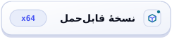

<!-- Glide README V2 (Persian RTL) | Zero-Cloudflare Hybrid Animated SVG + Real Screenshot Edition -->
<div align="center" dir="rtl">

<p><a href="README.md"><strong>English</strong></a> · <strong>فارسی</strong> &nbsp;|&nbsp; <a href="#get-started"><strong>دانلود</strong></a> · <a href="#features"><strong>امکانات</strong></a> · <a href="#screenshots"><strong>تصاویر برنامه</strong></a> · <a href="#glide-vs-v2rayn"><strong>تفاوت با v2rayN</strong></a> · <a href="#faq"><strong>پرسش‌ها</strong></a> · <a href="#verify-your-download"><strong>بررسی اصالت</strong></a> · <a href="#build-from-source"><strong>ساخت از سورس</strong></a></p>

<p>
<picture>
  <source media="(prefers-color-scheme: dark)" srcset="assets/svg/fa-hero-header-dark.svg">
  
</picture>
</p>

<p>
<a href="https://github.com/BlackkCore/Glide/releases/latest"></a>&nbsp;
<a href="https://github.com/BlackkCore/Glide/releases"></a>&nbsp;
<a href="LICENSE"></a>
</p>

<p>
<a href="https://github.com/BlackkCore/Glide/releases/latest/download/Glide-setup-x64.exe"><picture><source media="(prefers-color-scheme: dark)" srcset="assets/svg/fa-cta-installer-dark.svg"></picture></a>&nbsp;&nbsp;<a href="https://github.com/BlackkCore/Glide/releases/latest/download/Glide-windows-x64.zip"><picture><source media="(prefers-color-scheme: dark)" srcset="assets/svg/fa-cta-portable-dark.svg"></picture></a>
</p>

<p><sub>ویندوز ۱۰ و ۱۱ (x64) · <a href="https://github.com/BlackkCore/Glide/releases/latest">فایل‌های ۳۲ بیتی و همهٔ نسخه‌ها</a> · <a href="https://g1ide.pages.dev/">وب‌سایت</a></sub></p>

<p>
<picture>
  <source media="(prefers-color-scheme: dark)" srcset="docs/images/readme/fa-hero-stage-dark.png">
  
</picture>
</p>

<p>
<picture>
  <source media="(prefers-color-scheme: dark)" srcset="assets/svg/fa-hero-hud-dark.svg">
  
</picture>
</p>

</div>

<div dir="rtl">

<a id="features"></a>

## امکانات

همهٔ امکانات ضروری، بدون شلوغی؛ از اولین اتصال تا صدمین.

</div>

<picture>
  <source media="(prefers-color-scheme: dark)" srcset="assets/svg/fa-bento-features-dark.svg">
  
</picture>

<p align="center" dir="rtl"><sub><b>وضعیت تأییدشده</b> · <b>به‌روزرسانی امضاشده</b> · <b>عیب‌یابی مرحله‌به‌مرحله</b> · <b>سریع‌ترین سرور</b> · <b>دسترسی سریع Ctrl+K</b> · <b>کنترل از کنار ساعت</b> · <b>Midnight Aurora</b> · <b>فارسی و راست‌به‌چپ</b></sub></p>

<div dir="rtl">

<a id="get-started"></a>

## نصب و شروع کار

در کمتر از یک دقیقه جابه‌جا شوید. نسخهٔ نصبی و نسخهٔ قابل‌حمل هر دو هسته‌های Xray، sing-box و mihomo را همراه دارند.

</div>

<div align="center" dir="rtl">

<p>
<a href="https://github.com/BlackkCore/Glide/releases/latest/download/Glide-setup-x64.exe"><picture><source media="(prefers-color-scheme: dark)" srcset="assets/svg/fa-cta-installer-dark.svg"></picture></a>&nbsp;&nbsp;<a href="https://github.com/BlackkCore/Glide/releases/latest/download/Glide-windows-x64.zip"><picture><source media="(prefers-color-scheme: dark)" srcset="assets/svg/fa-cta-portable-dark.svg"></picture></a>
</p>

<p>
<picture>
  <source media="(prefers-color-scheme: dark)" srcset="assets/svg/fa-install-compare-dark.svg">
  
</picture>
</p>

</div>

<div dir="rtl">

۱. **خروج از v2rayN:** اگر v2rayN باز است، روی آیکون آن کنار ساعت راست‌کلیک کنید و گزینهٔ خروج را بزنید.
۲. **اجرای Glide:** اگر از v2rayN استفاده می‌کردید، می‌توانید اطلاعات قبلی را منتقل کنید. در غیر این صورت روی **افزودن سرور** بزنید و لینک کانفیگ یا لینک اشتراک را وارد کنید.
۳. **برقراری اتصال:** دکمهٔ پاور را بزنید. بار اول ممکن است Glide بگوید به داده‌های مسیریابی نیاز دارد (حدود ۴۵ مگابایت) و دکمهٔ **دانلود فهرست سایت‌ها** را نشان دهد؛ این داده‌ها یک بار از منابع عمومی در GitHub دانلود می‌شوند و هنگام به‌روزرسانی حفظ می‌شوند. وقتی وضعیت *متصل* نمایش داده شد، کار تمام است.
۴. وصل نمی‌شوید؟ روی **چرا وصل نمی‌شوم؟** بزنید تا برنامه مرحله‌به‌مرحله بررسی کند.

> [!TIP]
> Glide و v2rayN می‌توانند کنار هم نصب بمانند، فقط هم‌زمان اجراشان نکنید؛ هر دو از یک پورت محلی و یک تنظیم پروکسی ویندوز استفاده می‌کنند.

<a id="screenshots"></a>

## تصاویر برنامه

</div>

<picture>
  <source media="(prefers-color-scheme: dark)" srcset="docs/images/readme/fa-showcase-curated-dark.png">
  
</picture>

<details dir="rtl">
<summary><strong>تصاویر بیشتر:</strong> افزودن سرور، اپ‌های Microsoft Store، دریافت داده در اولین اجرا</summary>
<br>

<picture>
  <source media="(prefers-color-scheme: dark)" srcset="docs/images/readme/fa-showcase-more-dark.png">
  
</picture>

</details>

<div dir="rtl">

<a id="glide-vs-v2rayn"></a>

## تفاوت با v2rayN

> [!NOTE]
> Glide یک برنامهٔ دسکتاپ بازطراحی‌شده **بر پایهٔ v2rayN** است، نه یک هستهٔ پروکسی جداگانه. اتصال تأییدشده یعنی ترافیک از سرور شما عبور می‌کند؛ این به آن معنا نیست که همهٔ برنامه‌ها ناشناس یا محافظت‌شده‌اند.

**Glide در اصل همان v2rayN است، با رابط کاربری جدید و چند بهبود کاربردی.** پروتکل‌ها، روش‌های انتقال، فرمت پیکربندی، هسته‌ها، مسیریابی، DNS و TUN پروژهٔ اصلی حفظ شده‌اند. Glide علاوه بر بازطراحی نحوهٔ استفاده از آن‌ها، وضعیت تأییدشدهٔ اتصال، به‌روزرسانی امضاشده (برای Glide، هسته‌ها و فایل‌های قوانین)، نصب برای همهٔ کاربران و رابط فارسی را اضافه کرده است.

</div>

<picture>
  <source media="(prefers-color-scheme: dark)" srcset="assets/svg/fa-upstream-diff-dark.svg">
  
</picture>

<br>

<picture>
  <source media="(prefers-color-scheme: dark)" srcset="assets/svg/fa-verify-flow-dark.svg">
  
</picture>

<div dir="rtl">

Glide تغییرات پروژهٔ اصلی [2dust/v2rayN](https://github.com/2dust/v2rayN) را دنبال می‌کند: نسخه‌های جدید آن ادغام می‌شوند و همراه با بازطراحی در این مخزن منتشر می‌شوند.

<a id="details"></a>

## همهٔ امکانات

<details open>
<summary><strong>اتصال و بررسی وضعیت</strong></summary>
<br>

- **اتصال با یک دکمه:** پروکسی ویندوز را با دکمهٔ اصلی روشن یا خاموش کنید. زیر دکمه، نام و پرچم سرور، پروتکل، مدت اتصال، سرعت دانلود و آپلود و نمودار سرعت نمایش داده می‌شوند.
- **نمایش وضعیت واقعی اتصال:** Glide پیش از نمایش «متصل»، یک تست واقعی انجام می‌دهد و میزان تأخیر را نشان می‌دهد. اگر مشکلی وجود داشته باشد، پیام‌هایی مثل «در حال بررسی اتصال…»، «بدون اینترنت»، «پورت اشغال است» (همراه با نام برنامهٔ مربوط) یا «موتور متوقف است» را با دکمهٔ رفع مشکل می‌بینید.
- **اعلان قطع و وصل:** وقتی اتصال قطع شود یا دوباره برقرار شود، Glide به شما خبر می‌دهد. تا وقتی مشکلی وجود دارد، یک نقطهٔ قرمز روی آیکون برنامه کنار ساعت دیده می‌شود.
- **«چرا وصل نمی‌شوم؟»:** اینترنت، DNS، هستهٔ برنامه، سرور، عبور ترافیک و IP خروجی را بررسی می‌کند و نتیجه را به زبان ساده می‌گوید. **تست نشت DNS** نیز در دسترس است.
- **نمایش IP خروجی و کشور:** آی‌پی و کشور اتصال، پس از اجازهٔ شما، روی کارت وضعیت نمایش داده می‌شود.
- **انتخاب خودکار سریع‌ترین سرور:** برای هر اشتراک فعال می‌شود و از بهترین سرور شناخته‌شده شروع می‌کند تا ثانیه‌های اول خطا ندهد.
- **تداخل نداشتن با برنامه‌های دیگر:** تنظیمات پروکسی برنامه‌های دیگر را تغییر نمی‌دهد و روی پورت اشغال‌شده اجرا نمی‌شود.
- **مسیریابی ساده‌تر:** کلید **دریافت همهٔ برنامه‌ها (TUN)** با برچسب مدیر و امکان **انتخاب برنامه‌ها برای مسیریابی** برای تفکیک مستقیم و پروکسی. در رابط فارسی، تنظیمات پیشنهادی ایران در اولین اجرا نمایش داده می‌شود.
- **منوی کنار ساعت:** وضعیت اتصال و سرور را ببینید، با یک کلیک وصل یا قطع شوید و به سرورهای محبوب دسترسی داشته باشید.

</details>

<details>
<summary><strong>سرورها و اشتراک‌ها</strong></summary>
<br>

- **فهرست خوانای سرورها:** هر سرور در یک ردیف با پرچم دایره‌ای کشور، نام، پروتکل و پینگ رنگی (فیروزه‌ای سریع، کهربایی کند، قرمز ناموفق). نمای جدولی نیز یک کلیک فاصله دارد.
- **مرتب‌سازی و جستجو:** مرتب‌سازی بر اساس سرعت یا نام، جستجو هم‌زمان با تایپ، و پین کردن **سرورهای محبوب** در بالا کنار **سرورهای اخیر**.
- **مدیریت چند اشتراک:** انتخاب‌گر اشتراک با جستجو و نمایش آدرس ارائه‌دهنده برای اشتراک‌های هم‌نام.
- **وضعیت اشتراک:** حجم مصرف‌شده و باقی‌مانده، روزهای مانده تا انقضا و به‌روزرسانی خودکار هر ۶، ۱۲ یا ۲۴ ساعت (یا دستی).
- **افزودن آسان سرور:** چسباندن لینک یا آدرس اشتراک با پیش‌نمایش، اسکن QR از صفحه یا تصویر و فرم دستی برای ۱۲ پروتکل.
- **شناسایی لینک کپی‌شده:** با برگشتن به Glide پیشنهاد افزودن لینک کپی‌شده را می‌دهد.
- **دسترسی سریع (`Ctrl+K`)** برای جابه‌جایی فوری بین سرورها و **ارسال به گوشی** با QR کد.

</details>

<details>
<summary><strong>تنظیمات، ابزارها و ظاهر</strong></summary>
<br>

- **منوی کناری مرتب** در سه گروه (اتصال، مدیریت، برنامه).
- **تنظیمات ساده و پیشرفته:** گزینه‌های روزمره در ابتدا، گزینهٔ «نمایش تنظیمات پیشرفته» برای بقیه و جستجو با `Ctrl+F`.
- **به‌روزرسانی همه:** به‌روزرسانی یک‌جای Glide، هسته‌های امضاشده و فایل‌های قوانین در نسخهٔ نصبی و قابل‌حمل.
- **گزارش مصرف اینترنت** برای امروز، این ماه، کل و هر سرور، با هشدار محدودیت روزانه.
- **خروجی عیب‌یابی** به صورت ZIP با حذف خودکار آدرس‌ها، رمزها و توکن‌ها.
- **تم Midnight Aurora** در دو حالت تاریک و روشن (یا خودکار)، گوشه‌های گرد ویندوز ۱۱ و انیمیشن‌های هماهنگ با تنظیمات ویندوز.
- **سازگار با پنجره‌های کوچک** و **انتقال آسان از v2rayN** بدون تغییر دادن فایل‌های اصلی v2rayN.
- **دسترس‌پذیری:** نام‌گذاری دکمه‌های آیکونی برای صفحه‌خوان‌ها.

</details>

<a id="updating"></a>

## به‌روزرسانی برنامه

- **نسخهٔ نصبی:** در نوار کناری **بررسی به‌روزرسانی** را باز کنید و **به‌روزرسانی همه** را بزنید: Glide (امضا بررسی می‌شود)، هسته‌ها (فقط نسخه‌های موجود در فهرست امضاشدهٔ Glide) و فایل‌های قوانین. هنگام نصب در `Program Files` ویندوز یک بار اجازهٔ مدیر می‌خواهد؛ خود Glide بدون آن اجرا می‌شود. اگر رد کنید، چیزی تغییر نمی‌کند.
- **نسخهٔ قابل‌حمل:** **بررسی به‌روزرسانی** را باز کنید و **به‌روزرسانی همه** را بزنید تا برنامه، هسته‌ها (فقط نسخه‌های امضاشدهٔ نگهدارندگان Glide) و فایل‌های قوانین با هم به‌روز شوند؛ یا ZIP جدید را روی پوشهٔ قبلی استخراج کنید (سرورها و تنظیمات شما در `guiConfigs` حفظ می‌شوند).

> [!IMPORTANT]
> پیش از جایگزین کردن دستی فایل‌ها، از پوشهٔ `guiConfigs` نسخهٔ پشتیبان بگیرید.

<a id="faq"></a>

## پرسش‌های متداول

<details>
<summary><strong>می‌توانم سرورها و تنظیمات v2rayN را به Glide منتقل کنم؟</strong></summary>
<br>

بله. Glide از همان فرمت تنظیمات v2rayN استفاده می‌کند و در اولین اجرا پیشنهاد می‌دهد سرورها و تنظیماتتان را منتقل کنید. پوشه و فایل‌های v2rayN تغییر نمی‌کنند.

</details>

<details>
<summary><strong>چرا Glide بلافاصله «متصل» نشان نمی‌دهد؟</strong></summary>
<br>

Glide اول بررسی می‌کند که ترافیک واقعاً از سرور انتخاب‌شده عبور می‌کند. اگر این بررسی ناموفق باشد، با **«چرا وصل نمی‌شوم؟»** علت را پیدا کنید.

</details>

<details>
<summary><strong>Glide به کجا وصل می‌شود؟</strong></summary>
<br>

Glide علاوه بر سرورها و آدرس‌های اشتراکی که خودتان وارد کرده‌اید، برای بررسی به‌روزرسانی به GitHub و برای تست اتصال به یک آدرس آزمایشی وصل می‌شود. نمایش IP خروجی پیش از فعال شدن از شما اجازه می‌گیرد و تست نشت DNS فقط زمانی اجرا می‌شود که خودتان آن را شروع کنید. آدرس‌ها و اطلاعات حساس از گزارش‌ها و فایل‌های عیب‌یابی حذف می‌شوند. کد منبع باز است و می‌توانید خودتان بررسی کنید.

</details>

<details>
<summary><strong>چرا Glide بار اول داده‌های مسیریابی را دانلود می‌کند؟</strong></summary>
<br>

فهرست‌های IP به کشور که مسیریابی و پرچم سرورها از آن‌ها استفاده می‌کنند، از داده‌های MaxMind GeoLite ساخته شده‌اند و در فایل دانلودی قرار ندارند. منبع این داده‌ها ذکر شده است، اما هنوز تأیید نشده که روش بازنشر و دریافت این فهرست‌ها با شرایط MaxMind سازگار باشد (فایل THIRD_PARTY_NOTICES.md را ببینید). Glide پیشنهاد می‌دهد آن‌ها را یک بار از منابع عمومی‌شان (حدود ۴۵ مگابایت) دانلود کند و هنگام به‌روزرسانی نگهشان می‌دارد. بدون اینترنت هم Glide اجرا می‌شود و منتظر این دانلود می‌ماند.

</details>

<details>
<summary><strong>چرا Windows SmartScreen هشدار می‌دهد؟</strong></summary>
<br>

ویندوز برای برنامه‌های جدیدی که گواهی امضای کد تجاری ندارند این هشدار را نشان می‌دهد. فایل را فقط از صفحهٔ رسمی [Releases](https://github.com/BlackkCore/Glide/releases) دانلود کنید و [امضای آن را بررسی کنید](#verify-your-download)، سپس *More info* و بعد *Run anyway* را بزنید.

</details>

<details>
<summary><strong>بعد از به‌روزرسانی، آیکون هنوز شکل قبلی است.</strong></summary>
<br>

ویندوز آیکون‌ها را ذخیره می‌کند. دستور `ie4uinit.exe -show` را اجرا کنید و Explorer را دوباره باز کنید، یا ویندوز را ری‌استارت کنید. ممکن است لازم باشد آیکون سنجاق‌شده در نوار وظیفه را برداشته و دوباره سنجاق کنید.

</details>

<a id="verify-your-download"></a>

## بررسی اصالت فایل دانلودشده

هر فایل انتشار یک امضای `.sig` دارد و کلید عمومی `Glide-public-key.asc` هم کنار آن‌ها قرار دارد. پیش از اعتماد به کلید، اثر انگشت آن را با این مقدار مقایسه کنید:

</div>

```text
218B 01F2 5642 A7A3 91BF  CC86 7D63 C285 D104 63CB
```

<div dir="rtl">

با نصب بودن [GnuPG](https://gnupg.org/)، فایل موردنظر، فایل `.sig` آن و کلید عمومی را از [صفحهٔ انتشار](https://github.com/BlackkCore/Glide/releases/latest) دانلود کنید و این دستورها را اجرا کنید:

</div>

```bash
gpg --import Glide-public-key.asc
gpg --fingerprint
gpg --verify Glide-setup-x64.exe.sig Glide-setup-x64.exe
```

<div dir="rtl">

نام فایلی را که دانلود کرده‌اید جایگزین کنید. در خروجی باید عبارت `Good signature from "BlackCore Glide Release"` و اثر انگشتی برابر با مقدار بالا را ببینید (دستور `gpg --fingerprint 218B01F25642A7A391BFCC867D63C285D10463CB` آن را نمایش می‌دهد). این کلید از نوع Ed25519 است و تا ۱۱ نوامبر ۲۰۲۸ معتبر است.

هر فایل ZIP یک فایل `.sig256` هم دارد که خود Glide پیش از نصب به‌روزرسانی بررسی می‌کند. کد منبع Glide و هسته‌های همراه آن (فایل‌های `*-source*.tar.gz` به‌همراه `SHA256SUMS-source-<نسخه>.txt`) به هر انتشار پیوست می‌شود تا بتوانید آنچه دانلود کرده‌اید را دوباره بسازید.

<a id="build-from-source"></a>

## ساخت برنامه از سورس

برای ساخت Glide به [.NET 10 SDK](https://dotnet.microsoft.com/download/dotnet/10.0) نیاز دارید:

</div>

```bash
git clone https://github.com/BlackkCore/Glide.git
cd Glide/v2rayN/v2rayN.Desktop
dotnet publish -c Release -r win-x64 --self-contained true -o ../../out
```

<div dir="rtl">

پوشهٔ `bin` که فایل‌های هسته‌ها داخل آن قرار دارند را کنار `Glide.exe` بگذارید، یا اجازه دهید پس از اولین اجرا از بخش **بررسی به‌روزرسانی** دانلود شوند.

## سازندگان، حقوق نشر و مجوز

**Glide** توسط [BlackCore](https://github.com/BlackkCore) توسعه داده شده و نگهداری می‌شود.

این نرم‌افزار بر پایهٔ پروژهٔ متن‌باز [v2rayN](https://github.com/2dust/v2rayN)، ساخته‌شده توسط [2dust](https://github.com/2dust) و مشارکت‌کنندگان آن، توسعه یافته است. Glide رابط کاربری را بازطراحی کرده و قابلیت‌های شبکهٔ پروژهٔ اصلی را حفظ می‌کند.

### توسعه‌دهندگان و ارجاع به سازندگان

- **توسعه‌دهنده و نگهدارنده:** [BlackCore](https://github.com/BlackkCore)
- **حقوق نشر مشارکت‌های اصلی:** © ۲۰۲۶ BlackCore و دیگر صاحبان حقوق مربوطه.
- **پروژهٔ پایه:** [v2rayN](https://github.com/2dust/v2rayN)
- **هسته‌ها:** [Xray](https://github.com/XTLS/Xray-core)، [sing-box](https://github.com/SagerNet/sing-box) و [mihomo](https://github.com/MetaCubeX/mihomo)
- **رابط کاربری:** [Avalonia](https://avaloniaui.net/) و [Semi.Avalonia](https://github.com/irihitech/Semi.Avalonia)
- **فونت‌ها:** Manrope، Vazirmatn و JetBrains Mono (تحت مجوز SIL Open Font License)
- **داده‌های مسیریابی** (فایل `geosite.dat` همراه بسته‌های انتشار است؛ بقیهٔ فایل‌ها هنگام اولین استفاده در برنامه دانلود می‌شوند): `geosite.dat` و `geoip.dat` از [Loyalsoldier/v2ray-rules-dat](https://github.com/Loyalsoldier/v2ray-rules-dat) (GPL-3.0، بر پایهٔ [v2fly/domain-list-community](https://github.com/v2fly/domain-list-community) با مجوز MIT)، `Country.mmdb` و `geoip-only-cn-private.dat` از [Loyalsoldier/geoip](https://github.com/Loyalsoldier/geoip) (CC-BY-SA-4.0) و `geoip.metadb` از [MetaCubeX/meta-rules-dat](https://github.com/MetaCubeX/meta-rules-dat) (GPL-3.0).

</div>

<div dir="ltr">

This product includes GeoLite Data created by MaxMind, available from https://www.maxmind.com.

</div>

<div dir="rtl">

### مجوز

Glide تحت [مجوز عمومی گنو نسخهٔ ۳ (GPL-3.0)](LICENSE) منتشر می‌شود.

کپی، تغییر و توزیع مجدد این نرم‌افزار مطابق شرایط GPL-3.0 مجاز است، به شرط رعایت الزامات مجوز و حفظ اطلاعیه‌های حقوق نشر و مجوزهای مربوطه.

برای جزئیات بیشتر دربارهٔ حقوق نشر و ارجاع به سازندگان، فایل [NOTICE.md](NOTICE.md) را مطالعه کنید.

**مخزن رسمی پروژه:** [Glide by BlackCore](https://github.com/BlackkCore/Glide)

</div>

<br>

<div align="center" dir="rtl">

<p>
<a href="https://github.com/BlackkCore/Glide/releases/latest">
  <picture>
    <source media="(prefers-color-scheme: dark)" srcset="assets/svg/fa-footer-dark.svg">
    
  </picture>
</a>
</p>

<p>اگر با مشکلی روبه‌رو شدید یا پیشنهادی دارید، از طریق <a href="https://github.com/BlackkCore/Glide/issues/new/choose"><strong>بخش Issues</strong></a> با ما در میان بگذارید.</p>

<p><sub>اگر Glide برایتان مفید بوده، با دادن ⭐ به مخزن GitHub کمک کنید افراد بیشتری آن را پیدا کنند.</sub></p>

<p><a href="https://github.com/BlackkCore/Glide/releases/latest">دانلود</a> · <a href="https://github.com/BlackkCore/Glide/issues">Issues</a> · <a href="https://g1ide.pages.dev/">وب‌سایت</a> · <a href="README.md">English</a></p>

</div>