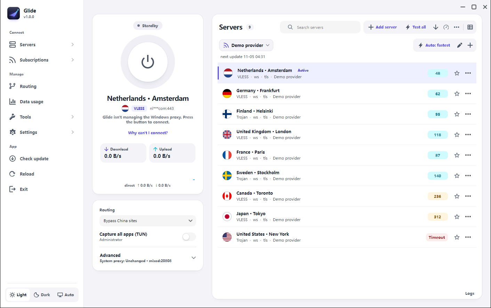
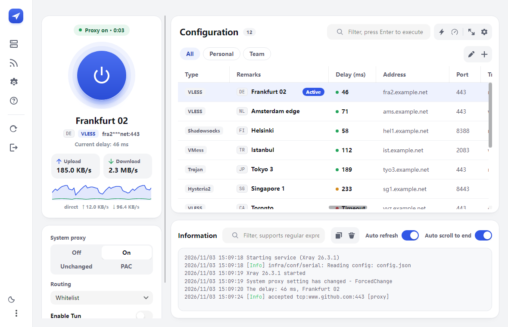
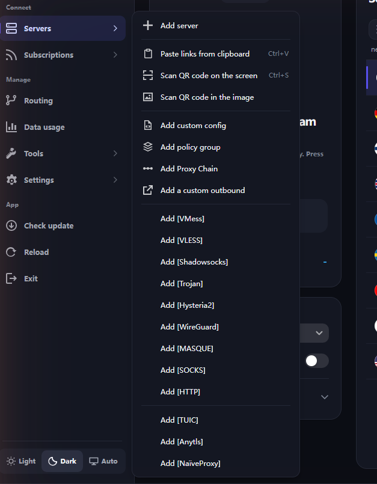
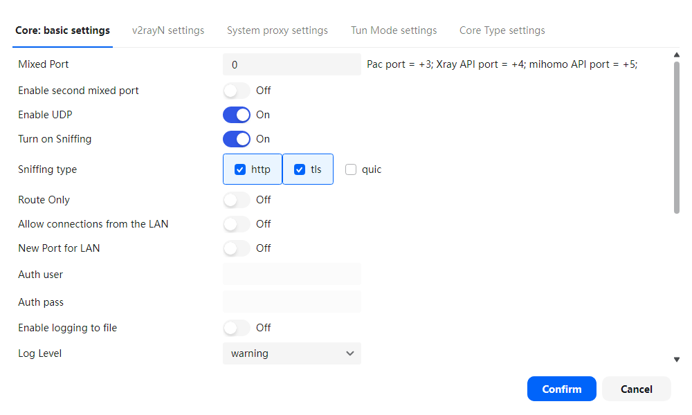
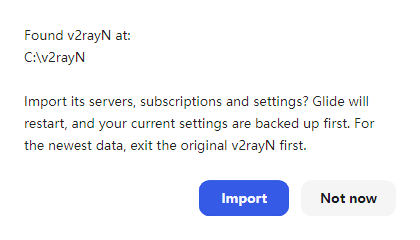
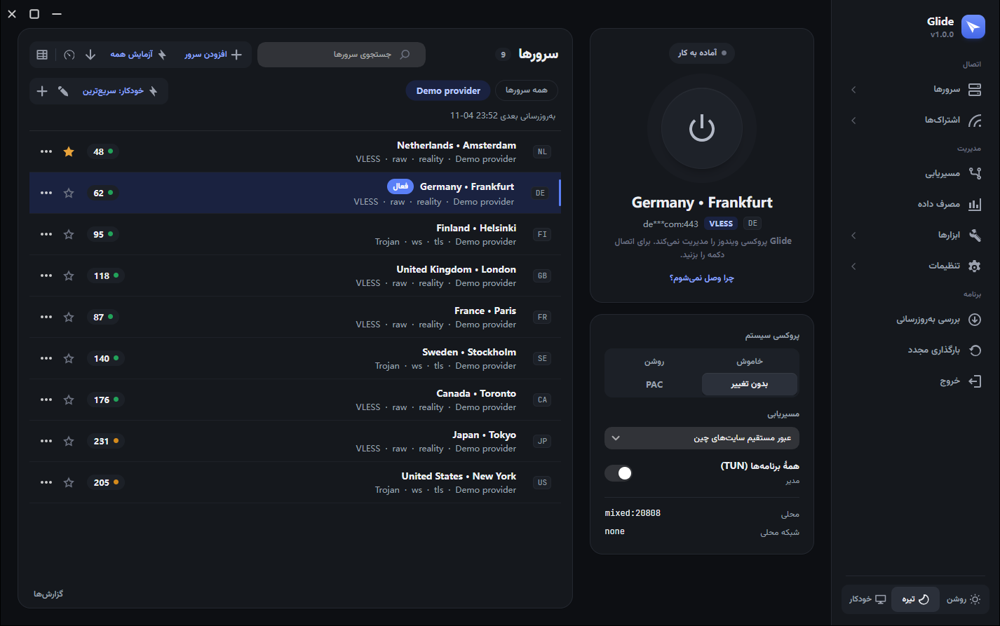

<div align="center">

**English** · [فارسی](README.fa.md)

<br>

<picture>
  <source media="(prefers-color-scheme: dark)" srcset="docs/brand/glide-logo-dark.png">
  
</picture>

<h3>A calm, modern Windows client for v2rayN</h3>

<p>The same engines you already trust (Xray, sing-box and mihomo),<br>in a window that is easy to read and pleasant to use.</p>

[](https://github.com/BlackkCore/Glide/releases/latest)
[](https://github.com/BlackkCore/Glide/releases)
[](https://github.com/BlackkCore/Glide/releases/latest)
[](README.fa.md)
[](LICENSE)

<br>

<a href="https://github.com/BlackkCore/Glide/releases/latest/download/Glide-setup-x64.exe"></a>
&nbsp;
<a href="https://github.com/BlackkCore/Glide/releases/latest/download/Glide-windows-x64.zip"></a>

<sub>32-bit Windows? See <a href="https://github.com/BlackkCore/Glide/releases/latest">all downloads</a>.</sub>

<br><br>

<picture>
  <source media="(prefers-color-scheme: dark)" srcset="docs/screenshots/main-dark.png">
  
</picture>

</div>

<br>

## ✨ Highlights

<table>
  <tr>
    <td width="33%" valign="top">
      <h4>⏻ One button to connect</h4>
      Press the power button and you're online. <i>Connected</i> only shows after Glide has checked that traffic really gets through.
    </td>
    <td width="33%" valign="top">
      <h4>🩺 "Why can't I connect?"</h4>
      A step-by-step check of your internet, DNS, the engine and the server, ending in one plain answer and a DNS leak test.
    </td>
    <td width="33%" valign="top">
      <h4>⚡ Auto: fastest server</h4>
      Glide keeps testing every server, uses the fastest one that works and switches by itself when one fails.
    </td>
  </tr>
  <tr>
    <td valign="top">
      <h4>📋 Paste, preview, done</h4>
      Copy a link and come back to Glide: it offers to add it. You see what was found before anything is imported.
    </td>
    <td valign="top">
      <h4>📊 Subscriptions you can read</h4>
      Data left, days to expiry, next update and early warnings, right under each subscription.
    </td>
    <td valign="top">
      <h4>🌙 Built for Persian, too</h4>
      A complete Persian translation, a mirrored right-to-left window, and a ready-made Iran routing preset.
    </td>
  </tr>
</table>

## 🔁 Glide and v2rayN

Glide **is** v2rayN underneath. Only the desktop interface is new.

<table>
  <tr>
    <th width="50%">Same as v2rayN</th>
    <th width="50%">Added by Glide</th>
  </tr>
  <tr>
    <td valign="top">

- Xray, sing-box and mihomo engines
- Every protocol and transport v2rayN supports
- The same config files, so your servers carry over
- Routing rules, DNS settings and TUN mode
- Upstream updates, merged in as they come out

</td>
    <td valign="top">

- A status that only says *Connected* when traffic works
- A plain-language connection check and DNS leak test
- Fastest-server mode with automatic fallback
- Subscription data, expiry and early warnings
- Preview before importing, and a clipboard offer
- Basic and advanced settings, with search
- A right-to-left Persian window
- One-click import from v2rayN

</td>
  </tr>
</table>

## 🧭 Everything Glide does

<details open>
<summary><b>Connecting</b></summary>
<br>

- **One button to connect.** The power button turns the system proxy on and off. Below it: the server, its protocol, a session timer, live upload and download speeds, and an optional speed graph.
- **A status that tells the truth.** *Connected* appears only after a real test, with the delay. Otherwise you see *Checking connection…*, *No internet*, *Port in use* (with the app holding it) or *Engine stopped*, each with one button that fixes it.
- **Notices when the connection drops,** and again when it's back. The tray icon shows a red dot while there's a problem.
- **"Why can't I connect?"** checks your own internet, DNS, Glide's engine, the server, real traffic and the exit IP, then gives one plain answer.
- **DNS leak check** through the tunnel, with Glide's own verdict.
- **Exit IP and country** on the status card, with a backup lookup service if the first one fails.
- **Auto: fastest server**, one click per subscription. It starts on the best-known server so the first seconds don't fail.
- **Never touches what isn't its own.** Glide won't change a Windows proxy that another program set, and won't start on a port another app is using.
- **Routing in plain words:** *Bypass China sites*, *Only listed blocked sites* and *Everything through proxy*. In Persian, Glide offers an Iran preset on first start.
- **"Capture all apps (TUN)"**, explained, with an *Administrator* label.

</details>

<details>
<summary><b>Servers and subscriptions</b></summary>
<br>

- **A list, not a spreadsheet.** One clear row per server with flag, name, protocol, a coloured delay pill and an ⋯ menu. The full table is one click away.
- **Sort** by fastest or by name, and **live search** as you type.
- **Favourites** stay at the top of the list and in the tray menu, next to your **recent servers**.
- **Add server, the easy way.** Paste links or a subscription address and see what was found first. Scan a QR code on screen or in an image, or fill in a form for 12 protocols.
- **Copied a link?** Switch back to Glide and it offers to add it, once per link.
- **Subscription status:** data used and left, days to expiry, last and next update. Warnings before a plan runs out.
- **Right-click a subscription** to update it now or pick how often it updates by itself (off, 6, 12 or 24 hours).
- **Quick switcher (Ctrl+K)** to jump to a server or run an action.
- **Send to phone:** a QR code for one server or a whole subscription.

</details>

<details>
<summary><b>Settings, tools and updates</b></summary>
<br>

- **A tidy sidebar** in three groups (Connect, Manage, App), with Routing and Data usage one click away and the rest under Tools and Settings.
- **Basic and advanced settings.** Everyday options first; *Show advanced settings* reveals the rest. Ctrl+F searches them all.
- **Update all.** One button updates Glide, the proxy engines and the rule files.
- **Choose apps for routing:** tick running apps (Telegram through the proxy, banking direct) instead of writing rules.
- **Data usage:** today, this month, in total and per server, with an optional daily limit.
- **Export diagnostics:** a zip of recent logs and settings for support, with addresses, passwords and tokens removed.
- **Private logs:** subscription and server addresses are cut down to the host name before they're written.
- **Simpler server form:** rarely needed fields wait behind *Show advanced fields*.

</details>

<details>
<summary><b>Look and feel</b></summary>
<br>

- **Light, Dark or Auto** (follows Windows), switched with a smooth crossfade.
- **Persian, done properly.** Complete translation, checked on every build, with the whole window mirrored right-to-left.
- **Fits any window.** Narrow windows get an icon-only sidebar; the log pane can be hidden; the speed graph can be turned off.
- **Feels native on Windows 11.** Rounded corners, a theme-aware title bar, and animations that respect Windows' *Animation effects* setting.
- **Accessible.** Icon buttons have names that screen readers announce.
- **Move over in one click.** On first start Glide finds your v2rayN and offers to import servers, subscriptions and settings, after backing up its own.

</details>

## 🖼️ Screenshots

<table>
  <tr>
    <td width="60%"></td>
    <td width="50%"></td>
  </tr>
  <tr>
    <td align="center"><sub>Sidebar menus with icons</sub></td>
    <td align="center"><sub>Compact layout for narrow windows</sub></td>
  </tr>
  <tr>
    <td width="50%"></td>
    <td width="50%"></td>
  </tr>
  <tr>
    <td align="center"><sub>Basic settings, with search</sub></td>
    <td align="center"><sub>One-click import from v2rayN</sub></td>
  </tr>
  <tr>
    <td colspan="2"></td>
  </tr>
  <tr>
    <td colspan="2" align="center"><sub>Persian, mirrored right to left</sub></td>
  </tr>
</table>

## 🚀 Get started

1. **Download** [`Glide-setup-x64.exe`](https://github.com/BlackkCore/Glide/releases/latest/download/Glide-setup-x64.exe) and run it. No admin rights needed; you get a Start menu entry and an uninstaller.
   <br><sub>Prefer portable? Take `Glide-windows-x64.zip`, extract it to a folder you can write to such as `C:\Glide` (not `Program Files`). 32-bit files are on the release page. The engines are included.</sub>
2. **Close v2rayN** if it's running (right-click its tray icon → *Exit*).
3. **Open Glide.** Accept the offer to import from v2rayN, or click **Add server** and paste a link or subscription address.
4. **Press the power button.** When it says *Connected*, you're done. If not, click *Why can't I connect?*.

**Requirements:** Windows 10 or 11, 64-bit or 32-bit.

> [!TIP]
> Glide and v2rayN can stay installed side by side. Just don't run both at once: they use the same local port and the same Windows proxy setting.

## 🔄 Updating

- In the sidebar, open **Check update** and press **Update all**. Glide, the engines and the rule files update together.
- Or download the new zip and extract it over the old folder. Your servers live in `guiConfigs` and are kept.

Glide follows [2dust/v2rayN](https://github.com/2dust/v2rayN): new upstream versions are merged in and released here with the redesign on top.

## ❓ FAQ

<details>
<summary><b>Is Glide safe? Where does my data go?</b></summary>
<br>

Besides your servers and subscription addresses, Glide contacts GitHub when you check for updates and a test address to confirm the connection works. The exit-IP lookup asks before it's turned on, and the DNS leak test only runs when you start it; both go through your own proxy. Logs and exported diagnostics have addresses and secrets removed.

</details>

<details>
<summary><b>Will my v2rayN servers and settings work?</b></summary>
<br>

Yes. Glide uses the same configuration format. On first start it offers to copy everything over from v2rayN; your v2rayN folder isn't changed.

</details>

<details>
<summary><b>Windows SmartScreen warns about the download.</b></summary>
<br>

New programs without a paid code-signing certificate get this warning. Click *More info* → *Run anyway*, or check the GPG signature below first.

</details>

## 🔐 Verify your download

Every release file has a `.sig` signature made with this key:

```text
D62D C3BC D066 5F52 5BB6  7206 E862 9FD9 AF46 1E53
```

```bash
gpg --import Glide-public-key.asc
gpg --verify Glide-windows-x64.zip.sig Glide-windows-x64.zip
```

`Glide-public-key.asc` is attached to every release. The output should say *Good signature from "BlackkCore Releases"*.

## 🛠️ Build from source

```bash
git clone --recursive https://github.com/BlackkCore/Glide.git
cd Glide/v2rayN/v2rayN.Desktop
dotnet publish -c Release -r win-x64 --self-contained true -o ../../out
```

You need the [.NET 10 SDK](https://dotnet.microsoft.com/download). Put a `bin` folder with the engines next to `Glide.exe`, or let *Check update* download them.

## 💙 Credits and license

- Built on [v2rayN](https://github.com/2dust/v2rayN) by [2dust](https://github.com/2dust) and contributors. The networking is all theirs; Glide changes the desktop interface.
- Engines: [Xray](https://github.com/XTLS/Xray-core), [sing-box](https://github.com/SagerNet/sing-box), [mihomo](https://github.com/MetaCubeX/mihomo).
- Interface: [Avalonia](https://avaloniaui.net/) with [Semi.Avalonia](https://github.com/irihitech/Semi.Avalonia). Fonts: [Manrope](https://github.com/sharanda/manrope), [Vazirmatn](https://github.com/rastikerdar/vazirmatn) and [JetBrains Mono](https://github.com/JetBrains/JetBrainsMono), under the [SIL Open Font License](v2rayN/v2rayN.Desktop/Assets/Fonts/OFL.txt).
- Licensed under [GPL-3.0](LICENSE), like v2rayN.

<div align="center">
<br>

Found a bug or have an idea? [**Open an issue**](https://github.com/BlackkCore/Glide/issues/new/choose)

<sub>If Glide makes your day a little easier, a ⭐ on the repo helps others find it.</sub>

</div>
