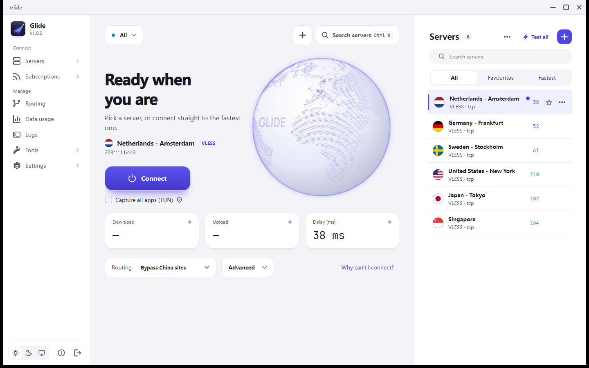
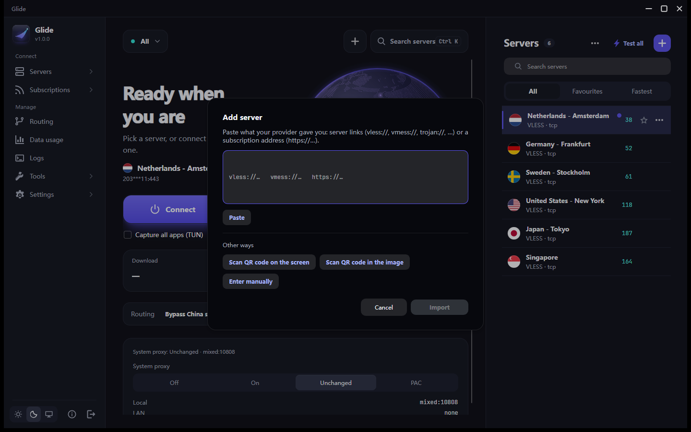
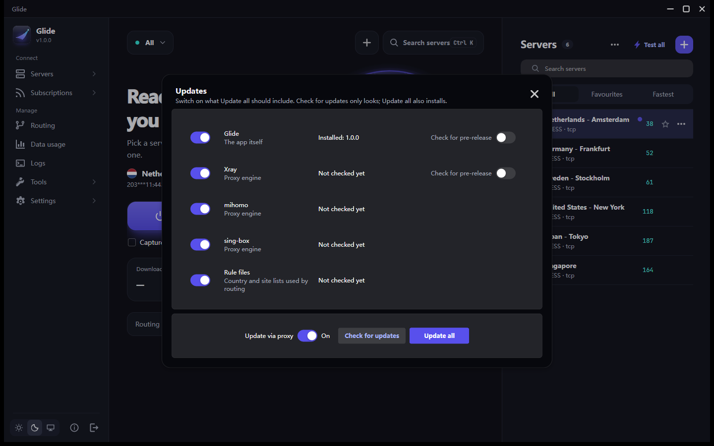
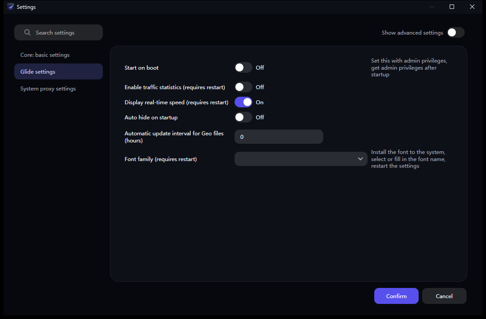
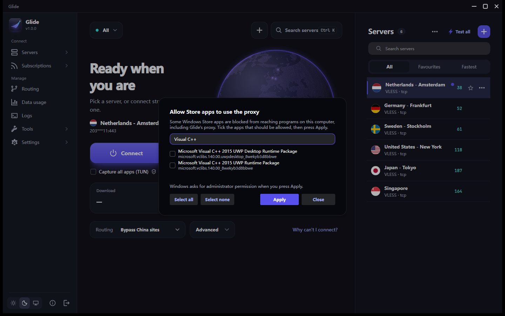
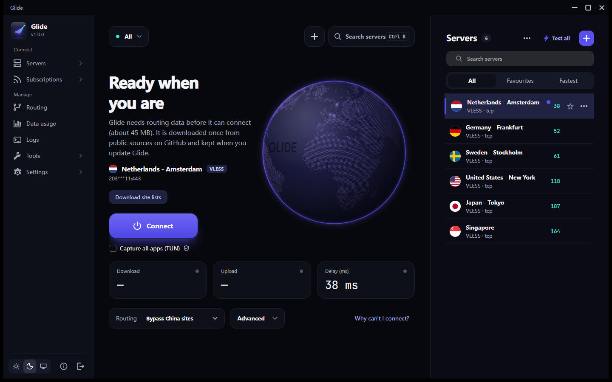
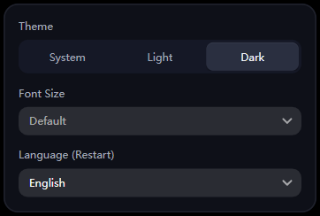

<div align="center">

<strong>English</strong> &nbsp;·&nbsp; <a href="README.fa.md">فارسی</a>

<br><br>

<picture>
  <source media="(prefers-color-scheme: dark)" srcset="docs/brand/glide-logo-dark.png">
  
</picture>

### Go anywhere. Quietly.

A calm, modern Windows client built on the power of **v2rayN**.<br>
Pick a server, press one button, and know for sure when you're connected.

[](https://github.com/BlackkCore/Glide/releases/latest)
[](https://github.com/BlackkCore/Glide/releases)
[](https://github.com/BlackkCore/Glide/releases/latest)
[](README.fa.md)
[](LICENSE)

<br>


<a href="https://github.com/BlackkCore/Glide/releases/latest/download/Glide-setup-x64.exe"></a>
<a href="https://github.com/BlackkCore/Glide/releases/latest/download/Glide-windows-x64.zip"></a>

<br><br>

<a href="https://g1ide.pages.dev/"></a>

<br><br>

<sub>Windows 10 & 11 · English & فارسی · Powered by Xray, sing-box and mihomo · <a href="https://github.com/BlackkCore/Glide/releases/latest">32-bit and all files</a></sub>


<br><br>

<picture>
  <source media="(prefers-color-scheme: dark)" srcset="docs/images/screenshots/glide-dashboard-dark.png">
  
</picture>

</div>

---

<div align="center">

### Everything essential, nothing in your way.

<sub>Built for the first connection, and the hundredth.</sub>

</div>

<table>
<tr>
<td width="33%" valign="top">
<h4>⏻ One button to connect</h4>
Press it and you're online. Once traffic is verified, it lights up with a cyan "protected" halo.
</td>
<td width="33%" valign="top">
<h4>✅ A status you can trust</h4>
<i>Connected</i> appears only after Glide has checked that traffic really gets through, with the delay.
</td>
<td width="33%" valign="top">
<h4>🩺 "Why can't I connect?"</h4>
A step-by-step check of your internet, DNS, the engine and the server, ending in one plain answer.
</td>
</tr>
<tr>
<td valign="top">
<h4>⚡ Auto: fastest server</h4>
Glide keeps testing your servers, uses the fastest one that works and switches by itself when one fails.
</td>
<td valign="top">
<h4>🗂️ Any number of subscriptions</h4>
One picker with search. Subscriptions with the same name show their provider's address, so you can tell them apart.
</td>
<td valign="top">
<h4>📋 Paste, preview, done</h4>
Copy a link or subscription and Glide offers to add it. You see what was found before anything is imported.
</td>
</tr>
<tr>
<td valign="top">
<h4>🌌 Midnight aurora design</h4>
Indigo for what you choose, cyan only when you're protected. Round country flags and pings coloured by speed.
</td>
<td valign="top">
<h4>🧭 A tray menu that informs</h4>
Live status at the top, one Connect / Disconnect item, your favourite and recent servers.
</td>
<td valign="top">
<h4>🌙 Made for Persian, too</h4>
Natural, everyday Persian, a fully mirrored right-to-left window in Vazirmatn, and an Iran routing preset.
</td>
</tr>
</table>

<div align="center">

### A closer look

<sub>Thoughtful details on every screen.</sub>

</div>

<table>
<tr>
<td width="50%"></td>
<td width="50%"></td>
</tr>
<tr>
<td align="center"><b>Paste, preview, done</b><br><sub>Add servers from a link, a subscription or a QR code</sub></td>
<td align="center"><b>Updates you control</b><br><sub>Choose what to check; the engines and rule files are listed separately</sub></td>
</tr>
<tr>
<td></td>
<td></td>
</tr>
<tr>
<td align="center"><b>Settings that make sense</b><br><sub>Everyday options first, with search</sub></td>
<td align="center"><b>Store apps, built in</b><br><sub>Windows' own tool, no extra helper (list filtered here)</sub></td>
</tr>
<tr>
<td></td>
<td></td>
</tr>
<tr>
<td align="center"><b>Routing data on first run</b><br><sub>Downloaded once, with your say</sub></td>
<td align="center"><b>English and فارسی</b><br><sub>Theme, font size and language in one place</sub></td>
</tr>
<tr>
<td colspan="2" align="center"><br><b>A native-feeling Persian interface</b><br><sub>Right to left, from layout to typography</sub></td>
</tr>
</table>

> [!NOTE]
> Glide is a redesigned desktop app **built on v2rayN**, not a separate proxy engine. A verified connection means traffic gets through your server; it doesn't make every app anonymous or protected.

---

## Get started

| Download | Best for | Notes |
| :--- | :--- | :--- |
| [**Installer (x64)**](https://github.com/BlackkCore/Glide/releases/latest/download/Glide-setup-x64.exe) | Most people | Windows asks for administrator permission (it installs into `Program Files`). Adds a Start menu entry and an uninstaller; your servers and settings stay in `%LOCALAPPDATA%\Glide`. |
| [**Portable zip (x64)**](https://github.com/BlackkCore/Glide/releases/latest/download/Glide-windows-x64.zip) | No installation | Extract to a folder you can write to, such as `C:\Glide` (not `Program Files`). |
| [**32-bit files**](https://github.com/BlackkCore/Glide/releases/latest) | 32-bit Windows | Installer and zip are on the release page. |

The engines are included in every download.

1. **Close v2rayN** if it's running (right-click its tray icon → *Exit*).
2. **Open Glide.** Accept the offer to import from v2rayN, or click **Add server** and paste a link or subscription address.
3. **Press the power button.** The first time, Glide may say it needs routing data (about 45 MB) and offer a **Download site lists** button; it downloads them once from public sources on GitHub and keeps them when you update Glide. When it says *Connected*, you're done.
4. Not connecting? Click **Why can't I connect?** for a guided check.

> [!TIP]
> Glide and v2rayN can stay installed side by side. Just don't run both at once: they use the same local port and the same Windows proxy setting.

**Jump to:** [Screenshots](#a-closer-look) · [All features](#all-the-details) · [Glide vs. v2rayN](#glide-vs-v2rayn) · [FAQ](#frequently-asked-questions) · [Verify your download](#verify-your-download) · [Build from source](#build-from-source)

## All the details

<details open>
<summary><strong>Connecting and troubleshooting</strong></summary>
<br>

- **One button to connect.** The power button turns the Windows proxy on and off. Below it: the server with its flag and protocol, a session timer, live download and upload speeds, and an optional speed graph.
- **A status that tells the truth.** *Connected* appears only after a real test. Otherwise you see *Checking connection…*, *No internet*, *Port in use* (with the app holding it) or *Engine stopped*, each with one button that fixes it.
- **Notices when the connection drops,** and again when it's back. The tray icon shows a red dot while there's a problem.
- **"Why can't I connect?"** checks your own internet, DNS, Glide's engine, the server, real traffic and the exit IP, then gives one plain answer. A **DNS leak test** runs on demand.
- **Exit IP and country** on the status card, after you allow the lookup.
- **Auto: fastest server**, one click per subscription, starting on the best-known server so the first seconds don't fail.
- **Never touches what isn't its own.** Glide won't change a Windows proxy another program set, and won't start on a port another app is using.
- **Advanced, out of the way.** The Windows proxy modes (Off, On, Unchanged, PAC) and local ports sit in an *Advanced* section with a one-line summary. It opens by itself if you use Unchanged or PAC.
- **Routing in plain words,** a **Capture all apps (TUN)** switch with an *Administrator* label, and **Choose apps for routing** to send single apps through the proxy or direct.

</details>

<details>
<summary><strong>Servers and subscriptions</strong></summary>
<br>

- **A list, not a spreadsheet.** One clear row per server with a round country flag, name, protocol, a delay pill coloured by speed (cyan fast, amber slow, red failed) and an ⋯ menu. The full table is one click away.
- **Sort** by fastest or by name, **search as you type**, and keep **favourites** at the top, next to your **recent servers**.
- **One subscription picker, however many you have,** with search. Same-named subscriptions show their provider's address.
- **Subscription status:** data used and left, days to expiry, last and next update, with warnings before a plan runs out. Right-click a subscription to update it now or pick how often it updates.
- **Add servers the easy way:** paste links or a subscription address and preview first, scan a QR code on screen or in an image, or fill in a form for 12 protocols.
- **Quick switcher (Ctrl+K)** to jump to a server or run an action, and **Send to phone** as a QR code.

</details>

<details>
<summary><strong>Settings, tools and look</strong></summary>
<br>

- **A tidy sidebar** in three groups (Connect, Manage, App).
- **Basic and advanced settings.** Everyday options first; *Show advanced settings* reveals the rest, and Ctrl+F searches them all.
- **Update all** updates Glide, the proxy engines (only to builds in Glide's signed engine list) and the rule files in one go, in the installed and the portable version. Each can be switched off, and *Check for updates* only looks.
- **Data usage** for today, this month, in total and per server, with an optional daily limit.
- **Export diagnostics:** a zip of recent logs and settings for support, with addresses, passwords and tokens removed. Logs shorten addresses to the host name.
- **Midnight aurora theme** in light, dark or auto, with a smooth crossfade, Windows 11 rounded corners and animations that follow Windows' *Animation effects* setting.
- **Fits any window:** narrow windows get an icon-only sidebar; the logs and speed graph can be hidden.
- **Accessible:** icon buttons have names that screen readers announce.

</details>

## Glide vs. v2rayN

**Glide is v2rayN underneath; only the desktop interface is new.** It keeps upstream's protocols, transports, configuration format, engines, routing, DNS and TUN, and redesigns how you use them.

| From v2rayN | Added or redesigned in Glide |
| :--- | :--- |
| Xray, sing-box and mihomo | A modern interface in the Midnight aurora design |
| Every protocol and transport v2rayN supports | A verified connection status and guided troubleshooting |
| The same config files, so your servers carry over | One-click migration, import previews and a clipboard offer |
| Routing rules, DNS settings and TUN mode | Plain-language routing, simpler settings with search |
| Upstream updates, merged in as they come out | Subscription insights, a searchable subscription picker, an informative tray menu and a Persian RTL interface |

Glide follows [2dust/v2rayN](https://github.com/2dust/v2rayN): new upstream versions are merged in and released here with the redesign on top.

## Updating

- **Installed version:** open **Check update** in the sidebar and press **Update all**: Glide (signature checked), the proxy engines (only builds in Glide's signed engine list) and the rule files. Windows asks for administrator permission once when Glide or an engine is installed into `Program Files`; Glide itself keeps running without it. If you decline, nothing is changed.
- **Portable version:** open **Check update** and press **Update all** to update Glide, the proxy engines (only builds that Glide's maintainers have vetted and signed) and the rule files together. Or extract the new zip over the old folder; your servers and settings live in `guiConfigs` and are kept.

> [!IMPORTANT]
> Back up the `guiConfigs` folder before replacing files by hand.

## Frequently asked questions

<details>
<summary><strong>Will my v2rayN servers and settings work?</strong></summary>
<br>

Yes. Glide uses the same configuration format and offers to import everything on first start. Your v2rayN folder isn't changed.

</details>

<details>
<summary><strong>Why doesn't Glide say "Connected" right away?</strong></summary>
<br>

Glide first checks that traffic really passes through the selected server. If the check fails, use **Why can't I connect?** to find out why.

</details>

<details>
<summary><strong>What does Glide connect to?</strong></summary>
<br>

Besides your servers and subscription addresses, Glide contacts GitHub when you check for updates and a test address to confirm the connection works. The exit-IP lookup asks before it's turned on, and the DNS leak test only runs when you start it. Logs and exported diagnostics have addresses and secrets removed. The source is open if you want to check for yourself.

</details>

<details>
<summary><strong>Why does Glide download routing data the first time?</strong></summary>
<br>

The IP-to-country lists that routing and server flags use are built from MaxMind GeoLite data and are not included in the download. Attribution is given, but whether the way these lists are republished and fetched satisfies MaxMind's terms has not been confirmed (see THIRD_PARTY_NOTICES.md). Glide offers to download them once from their public upstream sources (about 45 MB) and keeps them when you update. Without a connection Glide still starts; it waits for the download.

</details>

<details>
<summary><strong>Windows SmartScreen warns about the download.</strong></summary>
<br>

New apps without a paid code-signing certificate get this warning. Download only from the official [Releases](https://github.com/BlackkCore/Glide/releases) page and verify the signature below, then choose *More info* → *Run anyway*.

</details>

<details>
<summary><strong>The icon still looks like the old one after updating.</strong></summary>
<br>

Windows caches icons. Run `ie4uinit.exe -show` and reopen Explorer, or restart Windows. Pinned taskbar icons may need to be unpinned and pinned again.

</details>

## Verify your download

Every release file comes with a `.sig` signature and the public key `Glide-public-key.asc`. Check the key's fingerprint against this one before trusting it:

```text
218B 01F2 5642 A7A3 91BF  CC86 7D63 C285 D104 63CB
```

With [GnuPG](https://gnupg.org/) installed, download the file, its `.sig` and the public key from the [release](https://github.com/BlackkCore/Glide/releases/latest), then run:

```bash
gpg --import Glide-public-key.asc
gpg --fingerprint
gpg --verify Glide-setup-x64.exe.sig Glide-setup-x64.exe
```

Use the name of the file you downloaded. Look for *Good signature from "BlackCore Glide Release"* and a fingerprint that matches the one above (`gpg --fingerprint 218B01F25642A7A391BFCC867D63C285D10463CB` prints it). The key is an Ed25519 key that expires on 11 November 2028.

Each zip also has a `.sig256` file that Glide itself checks before it installs an update. The source code for Glide and the bundled engines is attached to every release as `*-source*.tar.gz` archives with `SHA256SUMS-source-<version>.txt`, so you can rebuild what you downloaded.

## Build from source

Requires the [.NET 10 SDK](https://dotnet.microsoft.com/download/dotnet/10.0).

```bash
git clone https://github.com/BlackkCore/Glide.git
cd Glide/v2rayN/v2rayN.Desktop
dotnet publish -c Release -r win-x64 --self-contained true -o ../../out
```

Put a `bin` folder with the engines next to `Glide.exe`, or let **Check update** download them after the first start.


## Credits and License

**Glide** is developed and maintained by
[BlackCore](https://github.com/BlackkCore).

Built upon [v2rayN](https://github.com/2dust/v2rayN)
by [2dust](https://github.com/2dust) and its contributors,
Glide introduces a redesigned desktop experience
while retaining the upstream networking capabilities.

### Development & Attribution

- **Developer & Maintainer:** [BlackCore](https://github.com/BlackkCore)
- **Original Contributions:** © 2026 BlackCore and respective contributors.
- **Upstream Project:** [v2rayN](https://github.com/2dust/v2rayN)
- **Engines:** [Xray](https://github.com/XTLS/Xray-core), [sing-box](https://github.com/SagerNet/sing-box), [mihomo](https://github.com/MetaCubeX/mihomo).
- **Interface:** [Avalonia](https://avaloniaui.net/) and [Semi.Avalonia](https://github.com/irihitech/Semi.Avalonia).
- **Fonts:** Manrope, Vazirmatn, and JetBrains Mono (SIL Open Font License).
- **Routing data** (downloaded in the app on first use, not bundled): `geosite.dat` and `geoip.dat` from [Loyalsoldier/v2ray-rules-dat](https://github.com/Loyalsoldier/v2ray-rules-dat) (GPL-3.0, built on [v2fly/domain-list-community](https://github.com/v2fly/domain-list-community), MIT), `Country.mmdb` and `geoip-only-cn-private.dat` from [Loyalsoldier/geoip](https://github.com/Loyalsoldier/geoip) (CC-BY-SA-4.0) and `geoip.metadb` from [MetaCubeX/meta-rules-dat](https://github.com/MetaCubeX/meta-rules-dat) (GPL-3.0). This product includes GeoLite Data created by MaxMind, available from https://www.maxmind.com.

### License

Glide is distributed under the
[GNU General Public License v3.0](LICENSE).

Redistribution and modification are permitted
under GPL-3.0, provided all applicable license
conditions and copyright notices are preserved.

For copyright details and attribution information,
see [NOTICE.md](NOTICE.md).

**Official Project:** [Glide by BlackCore](https://github.com/BlackkCore/Glide)


<div align="center">
<br>

Found a bug or have an idea? [**Open an issue**](https://github.com/BlackkCore/Glide/issues/new/choose)

<sub>If Glide makes your day a little easier, a ⭐ on the repo helps others find it.</sub>

[Download](https://github.com/BlackkCore/Glide/releases/latest) · [Issues](https://github.com/BlackkCore/Glide/issues) · [فارسی](README.fa.md)

</div>
