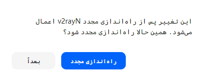

<div align="center">

<picture>
  <source media="(prefers-color-scheme: dark)" srcset="docs/brand/glide-logo-dark.png">
  
</picture>

**A redesigned v2rayN: the client you know, with a clean, modern interface.**
Same engine (Xray, sing-box, mihomo), same configs and subscriptions, a much nicer app to live with.

[](https://github.com/BlackkCore/v2rayN-Redesign/releases/latest)
[](https://github.com/BlackkCore/v2rayN-Redesign/releases)
[](https://github.com/BlackkCore/v2rayN-Redesign/releases/latest)
[](LICENSE)
[](#verify-your-download)

[**Download for Windows**](https://github.com/BlackkCore/v2rayN-Redesign/releases/latest) · [Features](#features) · [Getting started](#getting-started) · [فارسی](#فارسی)

<br>

<picture>
  <source media="(prefers-color-scheme: dark)" srcset="docs/screenshots/main-dark.png">
  
</picture>

</div>

---

## Features

**A first-run screen that helps you start**
No servers yet? Glide shows how to paste a share link or add a subscription, right where the list will be.

**See how long you have been connected**
The status pill shows a live session timer while the proxy is on.

**A connection screen you can read at a glance**
One big power button turns the system proxy on and off. The current server, its protocol and live upload/download speeds sit right underneath.

**A server list that is easy to scan**
Protocol badges, a clear *Active* tag, and latency shown as a colored dot: green is fast, amber is slow, red is timed out. Filter by subscription with one click.

**Light and dark themes**
Switch from the sidebar. On Windows 11 the title bar follows the theme too.

**Fits any window size**
Make the window narrow and the sidebar collapses to icons, so the server list keeps its room.

**Moving over takes one click**
On first start it finds your existing v2rayN and offers to bring over your servers, subscriptions and settings. Your current settings are backed up first. You can also run it any time from *Settings → Import from original v2rayN*.

**Restart when it matters**
Settings that need a restart (language, real-time speed and others) now offer a *Restart now* button instead of asking you to do it yourself.

**Made for Persian too**
Persian dialogs are laid out right-to-left, and the new texts are translated into Persian, Chinese and Russian.

**Updates itself**
*Help → Check update* downloads new versions of this app from this repository, and Xray, sing-box and mihomo from their own projects.

<table>
  <tr>
    <td></td>
    <td></td>
  </tr>
  <tr>
    <td align="center">Sidebar menus</td>
    <td align="center">Compact layout for small windows</td>
  </tr>
  <tr>
    <td></td>
    <td>
      <br><br>
      
    </td>
  </tr>
  <tr>
    <td align="center">Redesigned dialogs</td>
    <td align="center">One-click import and restart prompts</td>
  </tr>
</table>

---

## Getting started

1. Download **`v2rayN-windows-64-desktop.zip`** from the [latest release](https://github.com/BlackkCore/v2rayN-Redesign/releases/latest). It already includes the Xray, sing-box and mihomo cores.
2. Extract it to a folder you can write to, for example `C:\v2rayN`. Avoid `Program Files`.
3. If you use the original v2rayN, exit it first (right-click its tray icon → Exit).
4. Run **`v2rayN.exe`**. If it finds your old v2rayN it offers to import everything. Otherwise add servers from the *Configuration* menu: paste a share link, scan a QR code or add a subscription.

**Requirements:** Windows 10 or 11, 64-bit.

> [!TIP]
> Both apps can stay installed side by side, but don't run them at the same time. They use the same local port and would fight over the Windows proxy setting.

---

## Verify your download

Every release file comes with a `.sig` signature made with this key:

```text
D62D C3BC D066 5F52 5BB6  7206 E862 9FD9 AF46 1E53
```

```bash
gpg --import v2rayN-public-key.asc
gpg --verify v2rayN-windows-64-desktop.zip.sig v2rayN-windows-64-desktop.zip
```

`v2rayN-public-key.asc` is attached to every release. The output should say *Good signature from "BlackkCore Releases"*.

---

## Updating

- **The app:** *Help → Check update*, or download the new zip from Releases and extract it over the old folder (your `guiConfigs` folder with your servers stays).
- **Cores and rule files:** also from *Check update*.

This project follows [2dust/v2rayN](https://github.com/2dust/v2rayN). New upstream versions are merged in and released here with the redesign on top.

---

## Build from source

```bash
git clone --recursive https://github.com/BlackkCore/v2rayN-Redesign.git
cd v2rayN-Redesign/v2rayN/v2rayN.Desktop
dotnet publish -c Release -r win-x64 --self-contained true -o ../../out
```

Needs the [.NET 10 SDK](https://dotnet.microsoft.com/download). Copy a `bin` folder with the cores next to `v2rayN.exe`, or let *Check update* download them.

---

## Credits and license

- Built on [v2rayN](https://github.com/2dust/v2rayN) by [2dust](https://github.com/2dust) and its contributors. All the networking work is theirs; this fork changes the desktop interface.
- Cores: [Xray](https://github.com/XTLS/Xray-core), [sing-box](https://github.com/SagerNet/sing-box), [mihomo](https://github.com/MetaCubeX/mihomo).
- UI: [Avalonia](https://avaloniaui.net/) with [Semi.Avalonia](https://github.com/irihitech/Semi.Avalonia). Font: [Manrope](https://github.com/sharanda/manrope), under the [SIL Open Font License](v2rayN/v2rayN.Desktop/Assets/Fonts/OFL.txt).
- Licensed under [GPL-3.0](LICENSE), like the original.

Found a bug or have an idea? [Open an issue](https://github.com/BlackkCore/v2rayN-Redesign/issues).

---

<div dir="rtl">

## فارسی

**Glide** همان v2rayN است با ظاهری تازه، تمیز و مدرن. هسته‌ها (Xray، sing-box و mihomo)، کانفیگ‌ها و اشتراک‌ها همان قبلی‌ها هستند؛ فقط کار با برنامه بسیار راحت‌تر شده است.

### امکانات

- **صفحهٔ اتصال ساده:** یک دکمهٔ بزرگ برای روشن و خاموش کردن پروکسی سیستم، به همراه نام سرور و سرعت لحظه‌ای آپلود و دانلود.
- **لیست سرور خوانا:** نوع پروتکل، برچسب سرور فعال و نمایش تأخیر با رنگ (سبز: سریع، نارنجی: کند، قرمز: قطع).
- **تم روشن و تیره:** از نوار کناری عوض می‌شود و در ویندوز ۱۱ نوار عنوان هم هم‌رنگ می‌شود.
- **انتقال با یک کلیک:** در اولین اجرا، v2rayN قبلی شما را پیدا می‌کند و سرورها، اشتراک‌ها و تنظیمات را منتقل می‌کند (قبل از آن از تنظیمات فعلی نسخهٔ پشتیبان گرفته می‌شود).
- **دکمهٔ «راه‌اندازی مجدد»:** برای تنظیماتی که به ری‌استارت نیاز دارند.
- **پشتیبانی بهتر از فارسی:** پیام‌ها راست‌به‌چپ نمایش داده می‌شوند.
- **به‌روزرسانی خودکار:** از منوی راهنما ← بررسی به‌روزرسانی.

### شروع کار

۱. فایل **`v2rayN-windows-64-desktop.zip`** را از [آخرین نسخه](https://github.com/BlackkCore/v2rayN-Redesign/releases/latest) دانلود کنید (هسته‌ها داخل آن هستند).<br>
۲. آن را در پوشه‌ای مثل `C:\v2rayN` از حالت فشرده خارج کنید.<br>
۳. اگر v2rayN اصلی باز است، اول آن را ببندید (راست‌کلیک روی آیکون کنار ساعت ← خروج).<br>
۴. فایل **`v2rayN.exe`** را اجرا کنید و پیشنهاد انتقال تنظیمات را بپذیرید.

نیازمندی: ویندوز ۱۰ یا ۱۱، نسخهٔ ۶۴ بیتی.

این پروژه بر پایهٔ [v2rayN](https://github.com/2dust/v2rayN) ساختهٔ [2dust](https://github.com/2dust) است و مانند نسخهٔ اصلی تحت مجوز GPL-3.0 منتشر می‌شود.

</div>
